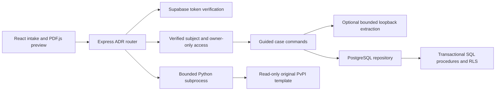
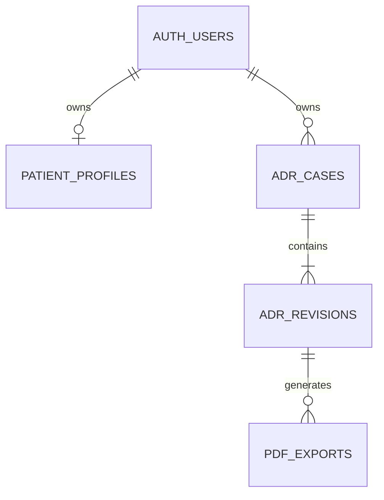
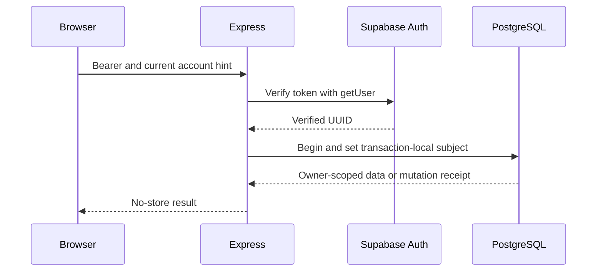
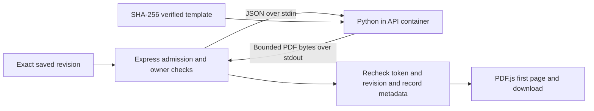
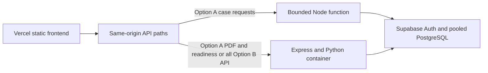

# ADR cloud API and deployment readiness

## Service boundaries

Task 1 establishes owner and revision constraints. Task 3 adds an owner-scoped receipt lookup. Mutations still use the existing atomic append procedure and preserve optimistic revisions. The account header catches stale UI sessions. It never grants access. Missing or invalid authentication returns 401, and an inaccessible case returns the same 404 as a nonexistent case.

## API

Base path is `/api/account/adr-guided`. Cloud requests require the Supabase access token and `X-APIP-Account` with the current user UUID. Legacy local development retains its existing cookie session. Successful responses remain compatible with existing intake and review.

| Method and path | Contract |
| --- | --- |
| GET / | Up to 100 owned case summaries. Pass `limit=1..50` and optional `after=<nextCursor>` for an indexed, owner-scoped page. |
| POST / | `{"fictionalOnly":true}`. Cloud requires a UUID `Idempotency-Key`, which becomes the case ID within the owner namespace. Returns 201 and the saved case view. |
| GET /:id | Current case, next question, missing fields, chronology warnings and template presence. |
| GET /:id/history | Latest 100 revisions by default. Pass `limit=1..50` and optional `before=<nextBefore>` to page through older revisions. |
| POST /:id/command | `expectedRevision` and `command`. Cloud requires a UUID `Idempotency-Key`. Commands are `confirm` (null means unknown), `add_medication`, `describe`, and `proposal`. |
| POST /:id/pdf | `expectedRevision`. Returns PDF bytes, `X-APIP-Revision` and attachment name. The same endpoint serves first-page preview and download. |
| GET /api/health | Process liveness. |
| GET /api/ready | Cloud Auth reachability, database procedure privileges and Python/template probe. Returns 503 if a check fails. Results are shared for ten seconds. |

Reuse the same key and body after an ambiguous mutation response. Reuse with changed content or expected revision returns 409. A successful replay returns the original saved snapshot, which can predate the current case head. Use GET to resume the latest state. The browser retries a network failure once and retains the key for the same pending action while that workspace remains open. After reloading or switching actions, inspect saved reports before creating a replacement. A stale command with a different key returns 409. Concurrent identical describe requests may duplicate extraction work before the commit, but only one revision is recorded. The legacy SQLite wire contract is unchanged.

Other bounded failures include 413 for the cloud JSON request limit, 422 for unsupported PDF input, 429 for capacity, and 503 for dependency or runtime failures. Unrecognized backend errors are reduced to a safe code. A provider outage saves the original description and keeps manual intake available.

## PDF processing

The container installs the pinned Python requirements. Mount the authorized original at `/app/docs/adr/templates/ADRRF_2.pdf` read-only. It is excluded from the build context. The probe imports both dependencies and opens the hash-verified original. Report bytes remain in memory, with a 20-second child deadline and 10 MiB output ceiling. The PDF slot stays busy until the child exits. Cloud metadata records each successful generation, including preview requests. No case text, tokens, PDF bytes, or child stderr enter production request logs.

## Deployment topology

**Recommend Option B.** The API allows PDF responses up to 10 MiB. Vercel Functions document a 4.5 MB request or response payload limit. The Node function also cannot assume availability of APIP's pinned Python environment or private template. Hosting the full API and PDF together keeps preview and export on the same authorization, revision and logging path. The local test exercises the subprocess with the original form. Vercel routing and the container image still need a private deployment rehearsal. [Vercel Function limits](https://vercel.com/docs/functions/limitations)

- Option B uses the root Dockerfile and `deployment/vercel-frontend.example.json` as the starting Vercel config. Replace the placeholder with the approved API origin. Verify the proxy forwards Authorization and Idempotency-Key, preserves PDF bytes, and respects no-store. Restrict ingress and enforce an approved access control at the hosting boundary.
- Option A stages `deployment/vercel-api.example.ts` as `api/[...path].ts` and uses `deployment/vercel-split.example.json` as the starting config. Use Node 24 and leave synchronous extraction disabled in the function. Route PDF and readiness to the same authenticated container. Validate the catch-all path and rewrite precedence in the private rehearsal. Budget payload limits for JSON snapshots too. [Vercel rewrites](https://vercel.com/docs/routing/rewrites)

## Setup and operations

1. Use a dedicated, authorized Supabase development project. Apply the four versioned migrations using the reviewed migration ledger. The first includes the profile bootstrap. For CLI v3 explicitly select the authorized remote and inspect pending migrations before applying. Keep `apip_adr` outside the Data API exposure list. The fourth migration provisions the dedicated NOLOGIN SQL writer and its three procedure grants. Activate the writer securely as described in the [hosted handoff](apip-development-handoff.md). Keep the role a member of `authenticated` with no ownership or BYPASSRLS. Runtime code creates no production schema.
2. Configure the Google OAuth Web application client and approved synthetic Google testers. Register the exact Supabase provider callback shown in its dashboard with Google. Put Google secrets in Supabase provider settings. Register exact app callbacks `http://localhost:3000/?apip_auth=1` and approved HTTPS equivalents in Supabase. Set the project Site URL and email redirect configuration. See the [authentication runbook](cloud-authentication.md).
3. Set `APIP_ACCOUNT_MODE=cloud`, `APIP_SUPABASE_URL`, `APIP_SUPABASE_PUBLISHABLE_KEY` and a server-only `APIP_ADR_DATABASE_URL`. In the frontend build, set the matching `VITE_SUPABASE_URL`, `VITE_SUPABASE_PUBLISHABLE_KEY`, and exact HTTPS origins in `VITE_APIP_AUTH_ORIGINS`. Cloud mode fails startup on incomplete configuration. Local mode is development only. An unset mode preserves existing local development when no cloud variables are present. Explicit `disabled` leaves the account API unavailable.
4. Use verified TLS and a transaction pool with named prepared statements disabled. Default pool maximum is 3 connections per API instance and configurable from 1 to 8. Transactions set a 5-second statement timeout and a 3-second lock timeout. Each process admits up to 24 active ADR requests, one PDF child, and one optional extraction. These are per-instance controls. Set hosting limits on replicas and request rate and calculate the total connection budget before increasing them. [Supabase connection guidance](https://supabase.com/docs/guides/database/connecting-to-postgres)
5. For Option B, mount the exact template read-only and inject secrets at runtime. Use a managed encrypted recovery point that includes Auth and PostgreSQL together. Rehearse restoration in an isolated project and verify matching Auth UUIDs, RLS, cases, revision heads and receipt replay. Use the [database recovery runbook](adr-postgres-foundation.md).
6. Use liveness and readiness separately. Enable `APIP_ADR_LOG_REQUESTS=1` for status and elapsed-time logs only. Configure ingress and provider logs to omit headers, callback query strings, bodies and case identifiers. Monitor timeouts, 429 rates and dependency failures. Keep future long-running work in a separate job system.

## CI and verification boundaries

Run frontend and strict backend TypeScript, production build, the local ADR/security and PostgreSQL wire suites, and simulated OAuth Chrome coverage. In a trusted private job with the verified template and pinned Python dependencies, run the native PDF and four-width ADR browser suites. Treat template skips as missing PDF coverage. Run the authorized two-user Google, TLS pooler, migration, outage, and deployment smoke tests as a separate gate.

The wire test uses the real PostgreSQL driver against disposable PGlite over TCP with a restricted SQL role and mocked token verification. Its query engine serializes transactions. Twelve parallel HTTP reads through a pool capped at three are a correctness check. They provide no managed Postgres throughput estimate. The socket interruption simulates database connectivity loss while retaining its fixture data. A real managed restart and cross-replica contention still require the authorized environment. PostgreSQL snapshot storage grows with revisions and statements. Original template and large overflow cases require a runtime capacity test before raising limits.

Real Google login, hosted PostgreSQL/TLS, production routing, real patient-data readiness, and public deployment are outside the verified evidence.

### Recorded local results

- 18 Node regressions passed. The TCP fixture covered two owners, absent/invalid credentials, concurrent duplicate creates, idempotent command replay, conflicting commands, history and case pagination, optional extraction success and outage, reconnect/resume, and the original PDF. The wire test found and corrected the adapter's JSONB encoding.
- The wire PDF was 723,757 bytes and took 2,906 ms including independent PDF parsing in the shared local test run. The fictional reaction matched its original AcroForm field.
- The native PDF suite passed four groups. Chrome passed simulated OAuth and the existing ADR workflow at 320, 360, 820 and 1440 px, including live page-one rendering and independent download reopening.
- Frontend and strict backend TypeScript, including the sample Vercel handler, and the production build passed. The existing large-bundle warning remains.
- Docker and Podman were unavailable on the workstation. The Dockerfile and Vercel samples are prepared for a private rehearsal. Their images and routing were not exercised. The existing local preview server returned HTTP 200 at the UI and liveness endpoint.
