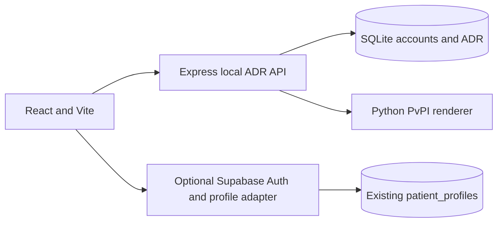
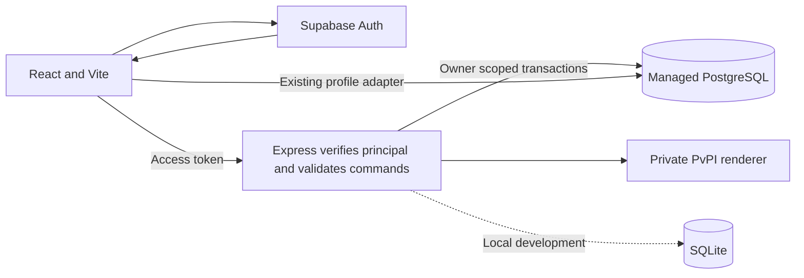
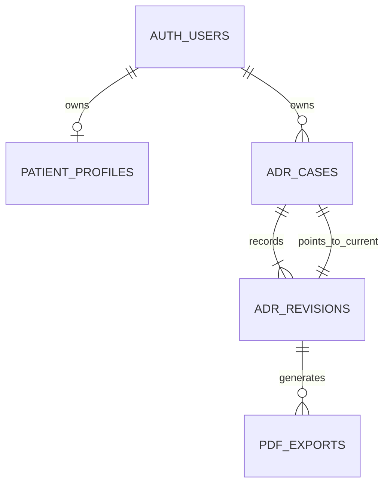

# ADR PostgreSQL foundation

Baseline is Phase 2 commit `c4a518c461c71c8822466e795d4fde119e31008f`, which contains merged development baseline `e2e33e0cbbf3c1fa4c3b5a95dbdf8459e12d60cb`. The Phase 2 checkout and its local data stay separate from this branch.

## Current and target





Task 1 supplies the ADR migration and repository boundary. The hosted Express authentication and PostgreSQL adapter are integration work. The current local route still uses its existing verified cookie session and SQLite. Supabase profile storage reuses the existing Auth identity, profile table, RLS, consent flags, and optimistic profile revision trigger. Consent flags do not grant a new principal access.

## Entities and constraints



[The migration](../supabase/migrations/20261105092036_adr_postgres_foundation.sql) keeps ADR tables in a private schema. Composite foreign keys bind every child to its owner's case or revision. A deferred foreign key binds the case head to a real revision. A snapshot preserves the existing domain document, including statements in order, medicine identities, confirmed field provenance, proposals, and provider state. Missing keys and explicit unknown values with a null value remain distinct. JSONB constraints check the envelope and medicine count. The existing TypeScript domain remains responsible for nested validation, input bounds, append-only statement semantics across versions, and proposal checks. Only the trusted API can submit a validated snapshot.

A saved revision is also its command audit record and idempotency receipt. It carries a timestamp, command kind, mutation UUID, and SHA-256 of a canonical request computed on the server. The mutation key is scoped to owner and case. An identical retry returns its saved revision even after the head advances. A changed request or expected revision under the same key fails. A stale new mutation fails. For case creation, the API must retain the same generated case UUID on retry. The future adapter should look up the receipt before expensive work and reuse the same key during retry. Concurrent attempts can duplicate pre-commit compute, while the database commits one revision. PDF metadata records the exact revision, template and bytes digests, and size. It records generation, not download or submission. The existing local renderer continues to stream the file.

## Access matrix

| Resource | Anonymous | Authenticated owner | Other authenticated user | Trusted Express |
| --- | --- | --- | --- | --- |
| Public patient profile | Denied | Own SELECT, INSERT, UPDATE and DELETE | Denied | Existing profile adapter |
| Private ADR cases | Denied | Own SELECT if connected via SQL | No visible rows | Append procedure advances head |
| Private ADR revisions and audit receipts | Denied | Own snapshot and audit kind via SELECT | No visible rows | Append procedure only |
| Private PDF metadata | Denied | Own SELECT if connected via SQL | No visible rows | Record procedure checks current revision |

Keep `apip_adr` out of exposed Data API schemas. Profile UPDATE uses both USING and WITH CHECK. ADR tables grant no direct mutation privileges or policies to client roles. History triggers reject revision and export UPDATE and DELETE. Private SECURITY DEFINER functions use a fixed empty search path, qualified names, a verified transaction subject and explicit owner filters. Function execution is revoked from browser roles. The trusted SQL role is a security boundary because it can set the subject. Treat its credentials like privileged server credentials and never use an owner ID from a request body or a user metadata role. The schema grants no specialist access.

## Repository and pagination

[GuidedCaseRepository](../server/adr/repository.ts) separates owner-scoped list/load/history and atomic compare-and-save from Express. The SQLite implementation preserves the original storage format and listing order. The PostgreSQL adapter should bind the same contract to verified sessions, use the SQL append procedure and translate conflict errors to existing HTTP responses. Add transport mutation keys and cursor support at integration. Preserve the current local API response shape until consumers adopt cursors.

Use keyset pagination on `(created_at, id)` descending with `owner_id = $1 AND (created_at,id) < ($2,$3)` after the first page. Fetch one extra row to detect a next page and cap page size. The owner-leading case index supports the seek. History uses the revision primary key and a descending revision cursor. Read current snapshots by joining the case head to its exact revision. Query plans and connection capacity need measurement with realistic data.

## Supabase development setup

1. Identify and authorize an isolated development project before connecting. Use fictional Auth users only. For a fresh project, the [first versioned migration](../supabase/migrations/20261105092031_apip_profile_bootstrap.sql) bootstraps profiles. For an existing project, compare its profile schema, policies, privileges and trigger to that migration and inspect the ledger before applying anything.
2. Use the reviewed Supabase CLI and its migration ledger. Confirm the selected development project and inspect `supabase migration list` and `supabase db push --dry-run` before applying pending migrations. Apply using `supabase db push` after review. Repeating the deployment skips the recorded migration. Do not replay raw DDL against an already migrated database or repair ledger entries without reconciling schema state.
3. Provision a dedicated server login role with inherited membership in `authenticated`, no ownership, no administrative role membership, and no BYPASSRLS. Grant that role EXECUTE on `apip_adr.append_revision(uuid,integer,uuid,text,text,jsonb)` and `apip_adr.record_pdf_export(uuid,integer,uuid,text,text,integer)`. Confirm direct table mutations fail. Store its connection secret in server configuration. Frontend configuration uses only the existing project URL and publishable key.
4. The future API validates the Supabase access token and derives the subject from that verification. Begin a transaction on a single checked-out connection, set the verified subject transaction-locally with parameterized `set_config`, and run every owner-scoped query and procedure on that same connection. Roll back on failure. Use a small pool and timeout budget per instance. Prefer Supavisor transaction mode for bursty serverless workloads and disable named prepared statements there. Use direct or session-mode connections for migrations and backup tools. Follow [Supabase connection guidance](https://supabase.com/docs/guides/database/connecting-to-postgres).

## Backup, scale and remaining gates

Use managed project backup or PITR for a consistent Auth and application recovery point. Restore to an isolated project and verify Auth owner IDs, profile consent, case-head foreign keys, revision counts and content, PDF hashes, migration history and role grants. For a portable logical export, use one consistent PostgreSQL dump snapshot for the application schemas, capture migration state and provision roles separately, and restore into a compatible sandbox with matching Auth identities already restored. Restore pre-data, data and post-data in dump order with failures treated as fatal. Never restore application data without the corresponding identity mapping. Check a fictional login, two owners, failed cross-owner reads and a new append after restore. Keep backup artifacts encrypted and access restricted. The fixture verifies a PGlite data-directory restore. Hosted backup, CLI migration ledger and managed roles require a development-project drill.

The existing limits remain 100 cases per owner, 500 revisions per case and 20 medicine rows per snapshot. Snapshot copying grows with revision count and accumulated statements. Measure storage, WAL, restore times, and contention before changing those limits. PDF rendering still needs a Python-capable private runtime, concurrency controls and a deployment packaging decision. The cloud adapter, token wiring, serverless load tests, managed advisors, account erasure/retention policy and consented import design remain gates. Restrictive Auth foreign keys intentionally block deletion while ADR history exists pending an approved erasure policy. Local identities and data are outside the cloud fixture.


For an isolated logical restore drill, configure named PostgreSQL connection services locally and inject credentials through the approved secret store. Provision the target roles and restore the matching Auth identities first. Example application-only dump and restore:

```sh
pg_dump --dbname=service=apip_dev --format=custom --schema=public --schema=apip_adr --file=apip-app.dump
pg_restore --dbname=service=apip_restore --single-transaction --exit-on-error --no-owner apip-app.dump
```

Use a restore identity approved to own the restored objects and preserve the function-owner trust boundary. Capture the migration ledger separately and reconcile it before running another migration. When Auth or other schemas may change during backup, use a managed recovery point or coordinate a single snapshot across exports. The application-only archive cannot recover Auth on its own.
