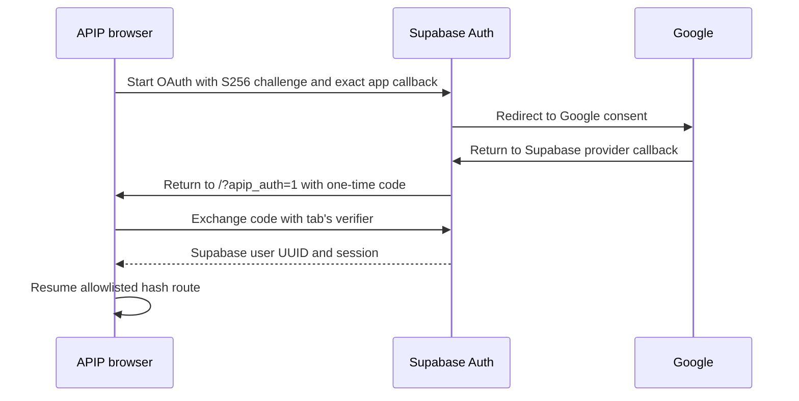
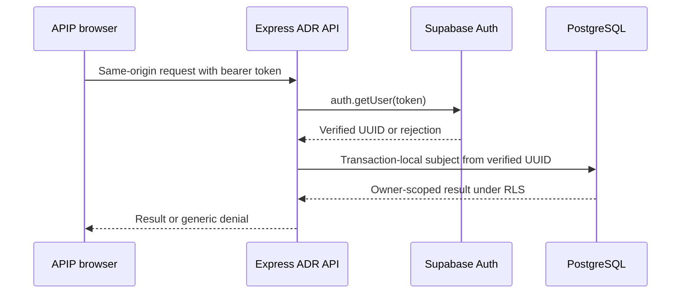

# Cloud authentication and ADR access

## Browser authentication

Email/password uses the same SDK. Email confirmation returns to the same app callback. Open confirmation links in the tab that requested them so the PKCE verifier is available. On cancellation or an invalid/expired code, APIP removes provider parameters from the URL and displays a retry message. The app stores only an allowlisted destination key for ADR or MedAssist and defaults to the dashboard. The UI includes recovery guidance. A self-service reset screen is outside this implementation.

Supabase SDK session storage is shared across tabs on the same browser origin so sign-out and account switches propagate. PKCE verifiers stay in session storage, scoped to the initiating tab. The SDK refreshes access tokens. Expired sessions stop exposing the signed-in UI while restoration runs. User-specific ADR and profile views remount on identity change. Browser-readable session storage requires strong XSS prevention and trusted scripts. Use HTTPS outside loopback and avoid exposing callback query strings in application or reverse proxy logs.

## Server authorization

The account header only detects a stale tab. All ADR reads, writes, history, and PDF endpoints require a verified, non-anonymous subject. Auth outages fail closed. Cloud PDF generation rechecks the token before recording revision-bound metadata and returning bytes. Sign-out removes browser sessions, while already issued access tokens can remain valid until their configured expiry. Keep token lifetimes short enough for the intended revocation window. The profile adapter uses Supabase's authenticated Data API and the existing profile RLS. Google identity is the Supabase Auth UUID. Email and display names confer no role. SQLite owners remain separate, with no email-based migration or linking. Production without cloud configuration has no local account route.

## Authorized development setup

1. Identify a dedicated Supabase development project and fictional/test identities. Apply the versioned profile and ADR migrations using the [database guide](adr-postgres-foundation.md). Supabase CLI v3 defaults to local commands. For an explicitly authorized hosted project, use the reviewed remote target and inspect the pending migrations before applying.
2. In Google Cloud, configure the OAuth consent screen and test users. Create a Web application OAuth client. Register the exact Supabase Google provider callback shown in the dashboard, typically `https://PROJECT.supabase.co/auth/v1/callback`, as Google's authorized redirect URI. Store the Google client ID and secret in the Supabase Google provider settings. [Supabase Google setup](https://supabase.com/docs/guides/auth/social-sign-in/auth-google)
3. Set the Supabase Site URL for that environment. Add the exact app URLs `http://localhost:3000/?apip_auth=1` and, if used, `http://127.0.0.1:3000/?apip_auth=1`. Add the equivalent callback only for explicitly approved HTTPS origins. Use separate projects or allowlists for development and production. Retain the confirmation template redirect target if customizing email. [Supabase PKCE flow](https://supabase.com/docs/guides/auth/sessions/pkce-flow)
4. Configure `VITE_SUPABASE_URL`, `VITE_SUPABASE_PUBLISHABLE_KEY` and comma-separated `VITE_APIP_AUTH_ORIGINS` for approved HTTPS app origins. Supply `APIP_SUPABASE_URL`, `APIP_SUPABASE_PUBLISHABLE_KEY` and `APIP_ADR_DATABASE_URL` to the Express process together. Both Auth settings must reference the same project. Use the dedicated SQL role and procedure grants from Task 1. Choose a TLS endpoint with a certificate trusted by Node. The adapter uses a small pool with named prepared statements disabled. Keep the database connection secret out of Vite variables and logs.
5. Restart Vite and Express with that configuration. Verify a hosted Google test user, repeat sign-in and check the stable UUID, then verify email signup/confirmation, profile reload, ADR save/download, and cross-account denial with two users. Repeat on each explicitly approved origin. Use fictional records only. Hosted identity and PostgreSQL connectivity remain release gates.

## Verification boundary

The local browser fixture intercepts provider traffic and checks the actual app's PKCE redirect and exchange, cancellation, email login, reload, refresh and cross-tab behavior. Node HTTP fixtures exercise the shared Express authorization boundary. PGlite checks database roles, RLS and persistence separately. The PostgreSQL driver connection and provider flows require the hosted development drill. Command retry keys remain a future transport concern. The server creates a new mutation ID for each accepted request and continues to reject stale revisions.
