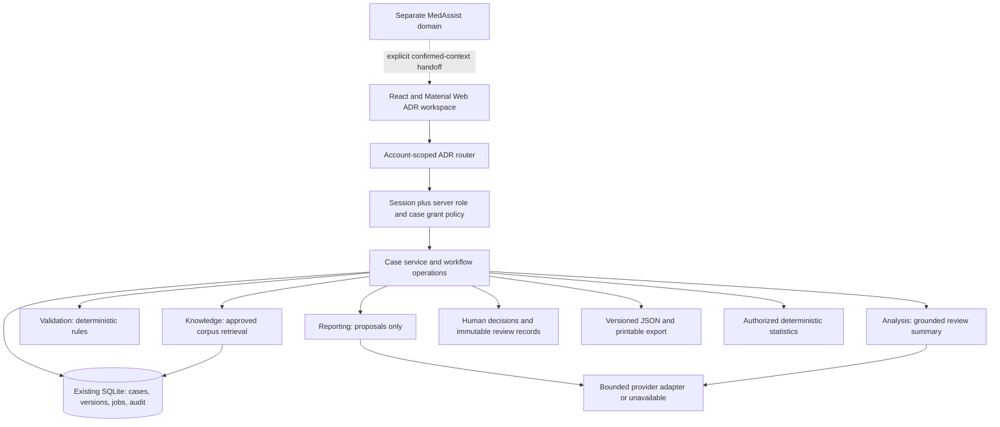
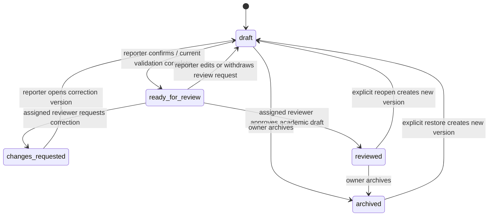
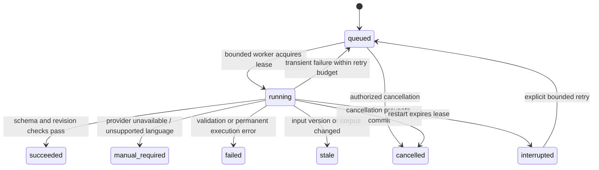

# Proposed ADR modular monolith

Status: **proposed**, based on the [audit](00-repository-audit.md). No application code is implemented by ADR-0.

## Minimum complete academic workflow

Required: authenticated fictional case create/save/reload; multiple suspected medicines and reported events; exact narrative preservation; structured **unconfirmed** extraction proposals; explicit accept/edit/reject actions; deterministic completeness/chronology checks; small approved-source retrieval; a citation-grounded review summary; role-and-case-scoped human review and corrections; structured JSON/print export; deterministic aggregate dashboard. All steps work manually when optional generation fails. Retrieval may return an explicit no-evidence result; it must never substitute fabricated knowledge.

The end-to-end sequence is **Intake → Draft → Reporting proposals → Human field confirmation → Validation → RAG → Analysis → Human case review → Export**. The additional field-confirmation gate prevents analysis of proposals as established facts. Original statements, confirmed facts and reviewer conclusions remain separate.

Required language boundary: English, Telugu-script, transliteration and mixed-language exact-text preservation/manual entry tests are separate. Only evaluated extraction paths can propose fields. Unsupported language yields `manual_required`, never an English default interpretation. Clinical wording in either language needs qualified review.

Stretch: OCR/photos/uploads, automatic drug coding, embeddings/hybrid retrieval, custom PDF rendering, hospital organizational workflows, dependent profiles, email/notifications, translation, hosted deployment and provider comparisons. Excluded: diagnosis, autonomous causality/seriousness inference, regulatory submission, signal detection, new model training, automatic trusted-corpus ingestion of cases and MedAssist qualification.

## Architecture



## Modules and boundaries

Each module uses contracts from [API and agents](03-api-and-agent-contracts.md), errors from `DomainError`, and storage from [database design](02-domain-and-database-design.md). Only the case/workflow service holds mutation capability for authoritative case records. Agent workers can read authorized immutable snapshots and return artifacts; orchestration persists those artifacts through controlled operations.

### A. Intake and case management

Responsibility: original statements, draft editing, versioning, confirmed-field operations and migration imports. Inputs: `CreateCase`, `DraftPatch`, `ProposalDecision`, authenticated principal. Outputs: `CaseView` and immutable `CaseVersion`. Dependencies: policy, repository, schema validation. Owns cases, versions, statements, medicines, events and field provenance. Errors: invalid input, stale revision, missing case, permission denial, storage busy. Tests: exact round-trip, null/zero/false, multi-medicine/event, stale write, atomic rollback, two-owner isolation, restart. It cannot label a case clinically approved.

### B. Reporting Agent

Responsibility: source-span-anchored suggestions from one snapshot. Input: `AgentInput` and allowed field paths. Output: `ExtractionResult` with proposal IDs, quotes and uncertainty, or `manual_required`. Dependencies: provider interface, prompt/schema registry, span checker. Owns no authoritative facts; workflow stores proposal artifacts in executions. Errors: unavailable/timeout/invalid JSON/unsupported language/unanchored claim. Tests: fabricated dose/date rejection, negation/context, unknown values and multilingual preservation. Never writes case fields or diagnoses.

### C. Validation Agent

Responsibility: deterministic draft completeness and consistency, not clinical validity. Input: snapshot plus rule-set version. Output: `ValidationResult`. Depends on schemas and pure date/missingness functions; no LLM. Owns version-bound findings through workflow persistence. Errors: invalid snapshot/rule mismatch; an incomplete case is a successful check with findings, not a system error. Tests: age zero, partial dates, onset before medicine as a flag rather than proof, unknown seriousness, unconfirmed-field exclusion and stable rule IDs.

### D. Knowledge/RAG Agent

Responsibility: retrieve approved versioned reference chunks. Input: confirmed medicine/event query terms, case version, corpus version. Output: `RetrievalResult` with exact chunk/section/hash references or `no_evidence`. Dependencies: corpus registry, FTS5 search and deterministic reranking. Owns corpus/chunks under operator ingestion; workflow owns per-case citations. Errors: corpus unavailable/withdrawn, query invalid, retrieval failure. Tests: no cross-case data, empty query abstention, source/hash resolution, ranking fixtures, injection text treated as data, withdrawal invalidation.

### E. Analysis Agent

Responsibility: assemble reported facts, missingness and supported reference observations for review. Input: confirmed snapshot, current validation and retrieval artifacts. Output: `AnalysisResult` with claim-to-citation mapping and limitations. Dependencies: provider adapter and deterministic claim checks; deterministic extractive fallback. Owns only a version-bound artifact. Errors: citation mismatch, unsupported assertion, stale evidence, provider failure. Tests: no causal conclusions, no unsupported facts/citations, contradictory/no evidence and provider outage. Statistics come from SQL, never a model.

### F. Workflow orchestrator

Responsibility: controlled transitions, run requests, durable execution claims/retries, artifact persistence, atomic audit and stale-result rejection. Input: authorized commands. Output: `ExecutionView` or case transition. Depends on A–E/G/H; calls functions directly rather than self-HTTP. Owns run state, deduplication and transition journal. Errors: conflict, blocked precondition, expired lease and retry exhaustion. Tests: duplicate request, lost response, restart recovery, edit during inference, role revocation, result/audit transaction failure. No agent may approve a report.

### G. Authentication and authorization

Responsibility: verified sessions and least-privilege policy checks on every route and worker commit. Input: cookie, consistency header and resource action. Output: `Principal`/authorization predicate. Dependencies: existing local session service, server-provisioned roles and explicit case grants. Owns role/grant management; never trusts UI-selected roles. Errors: unauthenticated 401, forbidden 403, hidden resource 404. Tests: other owner, guessed nested IDs, forged role/header, expired session, reviewer grant revoke, administrator without case grant. Local-only demo; no public auth claims.

### H. Persistent storage and audit

Responsibility: transactions, foreign keys, optimistic versions, bounded durable jobs and append-only application audit. Inputs: authorized repository operations. Outputs: saved version/artifact/audit IDs. Depends on existing SQLite connection exposed via a controlled seam. Owns persistence mechanics, not domain decisions. Errors: schema too new, busy, disk-full, integrity violation; rollback entire mutation on failure. Tests: restart, foreign-key violation, transactional audit, backup/restore, upgrade failure. Audit is not tamper-proof against the machine operator.

### I. Dashboard and review UI

Responsibility: case lists/detail, proposal comparison, findings/evidence/runs, explicit human decisions and authorized descriptive views. Inputs: API views; outputs: typed user commands. Depends on official Material Web wrappers and shared shell/account. Owns ephemeral UI state only. Errors: recoverable loading/save failures, 409 conflict and unavailable service; never silently changes store/account. Tests: keyboard/focus, 360/820/1440 px, reduced motion, long English/Telugu text, role differences and failed-save preservation.

### J. Report export

Responsibility: serialize an exact authorized version plus provenance/review/evidence. Input: `ExportRequest`. Outputs: UTF-8 JSON or escaped printable HTML with version/hash; draft exports watermarked. Dependencies: policy, immutable snapshot, serializers, audit. Owns export receipt, not case state. Errors: stale/unauthorized version, oversized output and unsupported format. Tests: long narratives, multiple medicines, Unicode, HTML injection, revision reconciliation, repeated export and access denial. No legacy E2B XML reuse.

## Workflow sequence

```mermaid
sequenceDiagram
  actor User
  participant UI
  participant API as Policy and case service
  participant DB as SQLite
  participant Run as Orchestrator
  participant Agents as Reporting / Validation / Knowledge / Analysis
  actor Reviewer
  User->>UI: Enter fictional narrative and medicine/event details
  UI->>API: Create/save (session, revision, idempotency key)
  API->>DB: Transaction: case version and audit
  UI->>API: Request reporting run on version N
  API->>DB: Persist queued execution
  Run->>Agents: Snapshot N; no case-write capability
  Agents-->>Run: Unconfirmed source-anchored proposals
  Run->>DB: Persist artifact if N still current
  User->>API: Accept/edit/reject fields explicitly
  API->>DB: New confirmed version and audit
  API->>Run: Validate confirmed version
  Run->>Agents: Deterministic validation, then retrieval, then analysis
  Agents-->>Run: Findings, citations, grounded summary or labeled fallback
  Run->>DB: Version-bound artifacts and audit
  User->>API: Request human review; acknowledge missingness
  Reviewer->>API: Review exact version; request changes or approve academic draft
  API->>DB: Decision and transition atomically
  User->>API: Export authorized version
  API-->>UI: Structured/printable report with review status and limitations
```

## Case and execution states



`reviewed` is academic record approval, not clinical sign-off. No `submitted_to_regulator` state exists. Export records an event; it does not change lifecycle. Pending findings/proposals are artifact statuses rather than additional case states. Editing approved content clears current review status but retains historic decisions.



Missing information stays unknown and generates clarification findings. Draft saving never requires complete fields. Ready-for-review requires a confirmed nonempty narrative, at least one provided suspect medicine and event, current validation with no blocking schema/consistency errors, no outstanding proposal decisions, and explicit reporter acknowledgement of remaining warnings/unknowns. It does not require a successful optional model. Analysis and retrieval may be explicitly unavailable/no-evidence and remain visible to the reviewer. Review approval requires acknowledgement of those limitations. Detailed retry/idempotency and permissions live in [contracts](03-api-and-agent-contracts.md).
