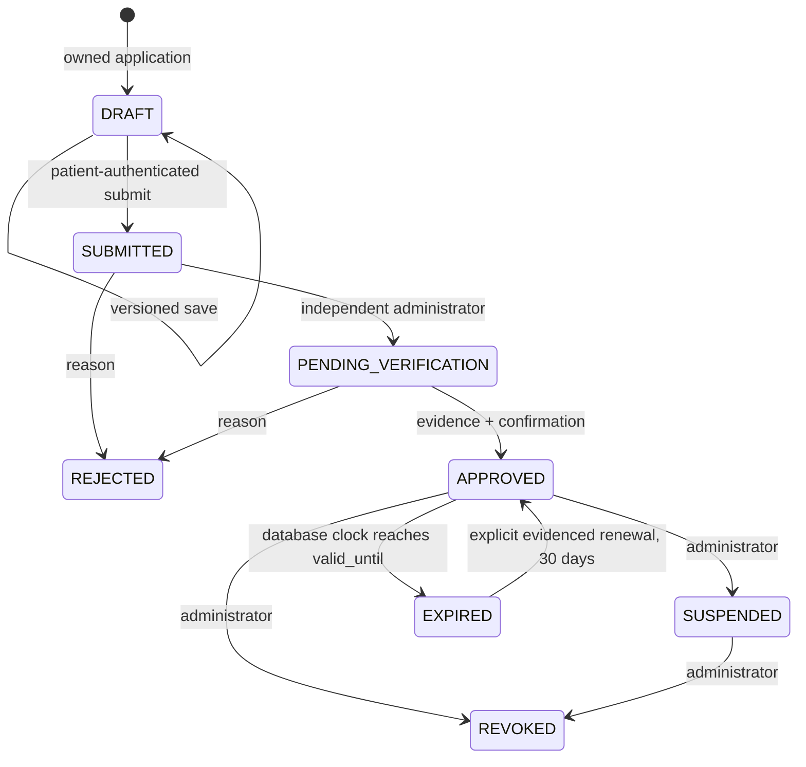
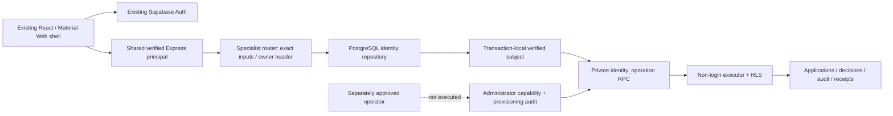

# Phase 3B — Specialist identity implementation and verification

Work date: 2026-11-08. Private fictional academic prototype only. Starting branch `codex/adr-phase3a-patient-case-management`, SHA `86920c097c0b02dfb63270713922039161f58cd6`; implementation branch `codex/adr-phase3b-specialist-identity`. Phase 3C has not started. PRs 6 and 7 remain open drafts and unmerged.

## Delivery and gates

- **PASS — implementation:** shared Supabase sign-in, own professional draft/profile/submission/status, private identity-administration list/detail, independent two-step decisions, immutable decision history, current capabilities and an empty specialist dashboard. Four fictional categories are supported. No patient medical records are requested by the specialist/admin workspace.
- **PASS — disposable security:** actual PostgreSQL via PGlite/wire protocol and the restricted application role, not only in-memory mocks. Self-approval, forged roles, foreign applications, direct writes, audit rollback, concurrent/stale decisions, duplicate replay, expiry and future-request revocation are tested.
- **PASS — hosted migration:** separately approved exact SQL applied to the development project as `20261107195900`. Ledger, exact SQL, RLS, ownership and EXECUTE checks were verified after application. These completed checks were reused without reapplying the migration.
- **PASS — hosted runtime:** port 3301 returns HTTP 200 from `/api/ready`, with `ready:true` and database/pdf/auth all true. The private launcher verifies the actual restricted writer using certificate and hostname verification. Anonymous capability/admin requests return 401 SIGN_IN_REQUIRED.
- **PASS — real hosted applicant browser completion, 2026-11-08 repair:** the same signed-in Chrome session verified capabilities HTTP 200, fictional profile creation/save/submission at version 3, reload/session restoration and administrator denial. [Focused root cause, exact approved SQL and before/after evidence](3b-hosted-specialist-repair.md). Live administrator approval is still blocked.
- **BLOCKED — live privileged decisions/revocation:** administrator UUID/bootstrap is not approved and has not been executed. All approval/rejection/suspension/revocation UI evidence uses clearly labeled disposable fictional fixtures. Zero live professional authority is inferred from fixture approvals.
- **PASS — patient regression:** four-width case dashboard, guided edit, saved history, original-form export, dark mode, logout and foreign-owner denial, using isolated SQLite and original PDF runtime. Existing patient SQL policies and original PDF mappings were not changed.
- **PASS — quality:** 36 affected Node/PostgreSQL/Auth/security/runtime regressions, four native-PDF Python test groups, frontend TypeScript, Vite configuration TypeScript, strict server/fixture TypeScript and production build. Browser checks use installed Chrome at 320/360/820/1440px with reduced motion and both themes. The final dialog/overflow repairs were checked in the browser; no unrelated sealed research suites were run.
- **PENDING — Google OAuth:** provider verification remains outside this stage. No new natural-token-expiry wait was run: the existing bearer verification boundary was reused, while professional authority is reread from PostgreSQL per request.

## Approved policy and state machine

The owner approved manual independent administration for the private fictional prototype, four categories (Pharmacovigilance Associate, Pharmacist, Clinical Reviewer, Pharmacovigilance Coordinator), 30-day authorization and explicit renewal. Qualifications remain applicant-declared until a human records a synthetic verification reference; this is not real-world professional credential verification.

EXPIRED is a derived view of a saved approval whose validity ended, not a background job rewriting decisions. No automatic renewal, appeals, rejected/revoked resubmission, unsuspension, document upload, professional clinical permission or case-sharing workflow was invented. Administrator identity administration does not confer specialist approval or access to someone else's patient record. Existing owner-patient rights remain independent.

## Authorization matrix

- Anonymous: no application/capability/admin access.
- Ordinary authenticated patient: own draft/application and capability status; no administration or professional case access.
- Pending/rejected applicant: own submitted profile/status/history only; cannot change submitted answers or approval.
- Approved, unexpired specialist: specialist identity shell; zero assigned-case, patient-revision or professional-PDF rights in Phase 3B.
- Suspended/revoked/expired specialist: no current specialist capability, even with the same valid Supabase session.
- Explicitly provisioned identity administrator: submitted application list/detail and bounded decisions; no private applicant drafts, patient narratives, cases or PDFs from that capability.
- Administrator impersonator or self-approver: denied. Workspace selection, email, user_metadata and submitted role fields confer no authority.
- Browser database roles PUBLIC/anon/authenticated: no privileged identity function execution or private-table access. Restricted writer: RPC execution only, no direct identity approval mutation; existing patient write restrictions remain.

## Architecture and database

Six private tables: `applications`, `decisions`, `audit_events`, `command_receipts`, `administrator_capabilities`, `provisioning_events`. All have RLS and are owned by the migration operator, not the RPC executor. Profiles are bounded JSONB; application owner is a foreign key to Auth. Version, state and validity checks are enforced. Decisions, audit, receipts and provisioning events are immutable. Provisioning events intentionally have no application RLS policy or runtime grants.

`identity_operation(text,uuid,integer,jsonb,uuid)` is SECURITY DEFINER with fixed empty search_path, owned by non-login `apip_identity_executor`; only `apip_adr_writer` can execute it. The executor has no BYPASSRLS, superuser, table ownership, role inheritance, role creation or ADR privileges. Browser roles and PUBLIC cannot execute the RPC/helper/immutability functions. The writer cannot become the executor. Operator ownership handoff leaves SET and INHERIT membership options false.

Every request installs the verified Auth subject transaction-locally. Actor locks, row locks, expected versions and JSONB fingerprints enforce bounded atomic decisions. A required audit failure rolls back state, decision and receipt. A repeated old approval returns current revoked state rather than restoring stale receipt privileges. No new function widens patient RLS. Session authentication and current professional authorization remain separate.

## Exact migration and hosted history

Repository: [20261107195900_specialist_identity_foundation.sql](../../../supabase/migrations/20261107195900_specialist_identity_foundation.sql).

Approved SHA-256: `009985b59439514430ccdcd280b11faf27b2d5bc84496380c56a6551f4d871ec`.

The original generated filename was `20261107184735_specialist_identity_foundation.sql`. Its first approved SQL failed with 42501 during managed-role ownership transfer and rolled back completely. A realistic non-superuser fixture reproduced that failure. The repaired SQL uses transaction-bounded SET ROLE membership for ownership handoff, narrow grants before handoff and no SET/INHERIT afterward. The owner separately approved its changed checksum. Supabase recorded the successful migration at `20261107195900`; the repository filename was reconciled to that existing ledger version without changing approved SQL bytes. `.gitattributes` preserves those bytes.

Existing five migrations remain intact, including historical PDF receipt version `20261107152504`. Exact applied statement text was compared with the approved file after application. Patient schema, RLS and latest-PDF function definition remained unchanged; existing hosted patient records were not read to make that claim. A populated Phase 3A fixture and restore test separately verified old saved data survived the additive migration.

Supabase advisors: intentional INFO for RLS-enabled provisioning events without application policy; pre-existing WARN for disabled leaked-password protection. Neither justifies weakening permissions or changing Auth configuration without authorization.

## Launcher repair and actual preview modes

The CA file was correct. One launcher used unavailable Get-FileHash; the next compared PEM bytes to a DER fingerprint. The local repair uses PowerShell 5.1-compatible .NET hashing, validating PEM SHA-256 `700723581420dd1ac98fd7e9ac529f0ef210eadcaf87fc868a3ad7d114c2f3b7` separately from DER SHA-256 `807025ad50d4ed219d2c9c7d299c004f824eb00cf7f65afef607d07b72e6cafa`. The authorized CA matches the authoritative [Supabase Root 2021 download](https://supabase-downloads.s3.ap-southeast-1.amazonaws.com/prod/ssl/prod-ca-2021.crt). No CA bytes, TLS verification or hostname checks were weakened.

The reusable [PowerShell launcher](../../../scripts/start-hosted-preview.ps1) sets NODE_EXTRA_CA_CERTS before Node starts, checks prerequisites before asking for a masked password and retains the writer connection only in its process environment. [Preflight](../../../scripts/hosted-preview-preflight.mjs) checks separate CA identities, free port, cloud mode, server build, original PDF hash/Python runtime, restricted pooler login, verified TLS and Auth health; it polls application readiness with a fixed bound. It never provisions an administrator. The existing private launcher remains outside Git; the tracked reusable launcher is parameterized and contains no machine path or credential.

- Hosted PostgreSQL Phase 3B: `http://127.0.0.1:3301/#/sign-in/specialist` and authenticated `#/specialist`. Readiness HTTP 200 verified. Administrator route `#/admin/specialist-applications` stays denied until separately approved bootstrap.
- Disposable specialist workflow: `http://127.0.0.1:3300/#/sign-in/specialist`. Actual disposable PostgreSQL plus existing local test authentication; prominent fixture label. It demonstrates the independent admin workflow without changing hosted privileges.
- Preserved SQLite preview: `http://[::1]:3000/#/`, health HTTP 200; separate Phase 3A SQLite instance at `http://127.0.0.1:3200/#/patient/adr/cases`, local session endpoint HTTP 200.
- Older hosted ports 3100/3101 were not reachable at final checks. They were not terminated or reconfigured by this work; do not advertise them as verified working URLs.

These are development-laptop loopback URLs, not public/shared deployments. No external preview tunnel was created.

## Browser and PDF evidence

Actual Chrome captures from the labeled disposable workflow:

- [320px application](evidence/3b/application-320.png)
- [360px controlled decision](evidence/3b/decision-approve-360.png)
- [820px administrator list](evidence/3b/admin-list-820.png)
- [1440px approved identity](evidence/3b/approved-1440.png)
- [1440px dark mode](evidence/3b/dark-1440.png)

The browser submits a fictional profile, reloads saved status, exercises keyboard confirmation, approval, timed-expiry fixture, explicit renewal, suspension, revocation, rejection, denied administration and account switching. It asserts no patient ADR API requests and no page errors. Official Material Web md-dialog is used; React custom-element `class` and explicit responsive dimensions avoid the earlier unstyled/clipped dialog. Bounded fields and select widths prevent mobile horizontal overflow. Evidence never represents a live professional approval.

Patient browser regressions independently generate and reopen current/historical PDFs after editing. Four Python groups cover original widgets/appearance, fitting two-page cases, overflow and reserved-field handling. The supplied template hash remains `40af4962d6dd65ce538ff4791805b0632085159623c5a4beeb755442f6c0ed0b`. No PDF mapping or generator source changed for this stage.

## File-by-file educational walkthrough

- `server/specialist/domain.ts`: separates applicant claims, policy, application state and effective authorization; no clinical rights.
- `repository.ts`: typed operations shared by the PostgreSQL adapter and explicitly disposable memory adapter.
- `postgresRepository.ts`: narrow RPC boundary, transaction-local identity and timeouts; no SQLite fallback.
- `router.ts`: authenticated resource operations, exact input keys, owner header, bounded failures and namespace fallthrough.
- `fixtureRepository.ts`: fast cloned-snapshot/idempotency/audit tests; never selected by production startup.
- `server/cloud-account.ts`: reuses the same verified Supabase principal and existing rate limits while mounting specialist routes beside preserved patient routes.
- `server/local-account.ts`: explicit specialist-unavailable local mode and existing readUser reuse solely for disposable browser authentication.
- `src/features/specialist/SpecialistWorkspace.tsx`: applicant profile/status and administrator console with safe retries, stale-response checks, owner remount, dirty-profile guard, decision confirmation and capability refresh.
- `specialist.css`: scoped Material 3 surfaces, responsive fields and official dialog dimensions; global header design untouched.
- `src/features/access/AccessPreview.tsx`: parses specialist/admin hash routes and reuses shared sign-in; `PreviewLayout.tsx` accepts the specialist screen type.
- `src/features/account/AccountSignIn.tsx`: shared real sign-in with an allowlisted specialist/admin return destination; no second credential service.
- `supabase/migrations/20261107195900_specialist_identity_foundation.sql`: additive private identity storage, RLS, immutable audit and restricted atomic operations.
- `database/operations/bootstrap-specialist-admin.sql`: separately governed one-time operator procedure; [runbook](../../../database/operations/README.md) explains required private approval. It has not run live.
- `scripts/specialist-identity.test.ts`: fast domain/memory authorization checks.
- `scripts/specialist-api.test.ts`: API contracts with mocked verified Auth; this is not hosted Auth evidence.
- `scripts/specialist-postgres.test.ts`: real disposable PostgreSQL role/RLS/transaction/bootstrap/migration/restore tests, including non-superuser ownership handoff.
- `scripts/specialist-fixture-runtime.ts`: separate disposable database and existing local auth; administrative test control uses the wire connection rather than interleaving raw PGlite calls into an application transaction.
- `scripts/specialist.browser.mjs`: real Chrome fixture user journeys and screenshots; `--serve` leaves a labeled local preview available.
- `scripts/specialist-hosted.browser.mjs`: optional private interactive hosted applicant verification; no credentials in source or outputs and no administrator grant.
- `scripts/hosted-preview-preflight.mjs`, its test and `start-hosted-preview.ps1`: reusable strict-TLS startup and bounded readiness checks.
- `.gitattributes`: exact approved migration byte preservation only.
- Phase 3B report/policy, journey/contracts/acceptance/prompt documents, architecture/development/ADR indexes, decisions, roadmap, history, changelog and subsystem READMEs: factual implementation and approval boundaries, not new feature authority.

## Remaining limits and next action

Administrator list UI shows the first 25 matching applications; backend cursor pagination is available but a full paging control is not implemented. Professional profile edits stop at submission; appeals/reinstatement and evidence document retention require policy. Applicant contact uses existing verified account email; no new sensitive contact-document store was introduced. Capability UI refreshes on focus/visibility and every 15 seconds; server denial applies on every subsequent privileged request immediately, independent of display refresh.

An out-of-band exact confirmed synthetic administrator UUID and bootstrap operation still require separate private selection and explicit approval. Until then the live administrator workflow is **BLOCKED**, not passed. Hosted applicant browser evidence now passes after the separately approved repair. Complete the authorized independent-administrator decision/revocation test before treating all live Phase 3B gates as closed.

**Assessment:** PASS for independently authorized Phase 3B implementation/fixtures and hosted migration/runtime; NO-GO for live specialist privilege activation or Phase 3C rollout while bootstrap and hosted privileged verification are incomplete. The [copy-ready Phase 3C prompt](3c-next-implementation-prompt.md) is a gated handoff only, not permission to start it.
