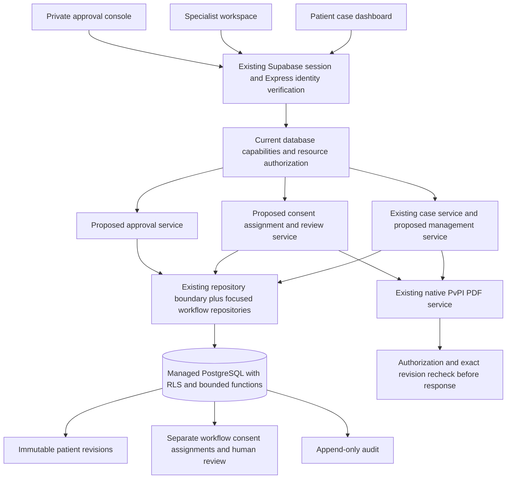
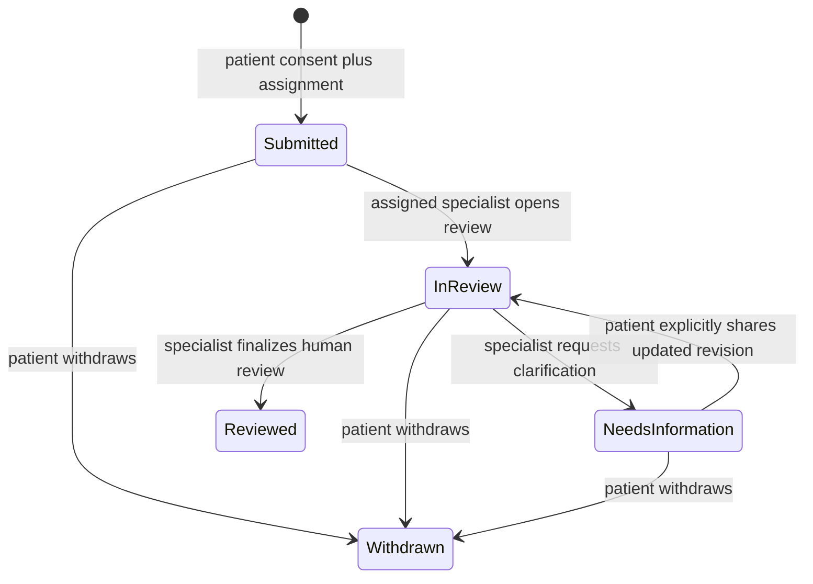

# ADR-1B 3A–3D detailed requirements and approval register

Reconciled supporting source from the interrupted planning session. The [master blueprint](../../architecture/ADR_PHASE3_MASTER_BLUEPRINT.md) owns the expanded stage boundaries.

**Prepared 2026-11-07. Planning only.**
Baseline branch `codex/apip-postgres-foundation`, commit `5c20ede3b9a2548646674e15a3d22914f4865a4e`, draft PR 6.
This package proposes future work. Application code, migrations, hosted configuration and schema remain untouched. Phase 0 now authorizes documentation commit/push only; implementation, migrations, merges and deployment remain unstarted.

## Navigation

- This document owns requirements, journeys, architecture, states, screens, risks, stage gates and approval questions.
- [Proposed data and API contracts](roles-consent-and-revisions.md) owns schema, permissions, transaction rules and endpoint details.
- [Stage implementation prompts](implementation-prompts.md) provides complete copy-ready prompts for 3A through 3D.
- [Hosted verification evidence](../../../database/hosted-verification-2026-11-07.md) owns actual backend results. Proposed Phase 3 tests below have not run.

## 1. Scope and baseline

The user selected Patient ADR Case Management and Secure Specialist Review Workflows. Phase 3A improves patient case management; 3B establishes approved specialist identity; 3C enables consented assignment and human review; 3D verifies integration and security.

The verified baseline includes Supabase Auth, managed PostgreSQL, server-verified bearer identities, a restricted writer, transaction-local subjects, owner isolation, immutable intake revisions, idempotent commands, conflict handling, native PvPI v1.4 generation, live first-page preview and the Material 3 Phase 2 interface. Local SQLite remains an independent development mode.

The implementation already exposes specialist sign-in presentation. Selecting that screen establishes no specialist privilege. Guided case DELETE is unimplemented. A previously observed 404 for DELETE establishes no deletion authorization.

Existing limits include 100 guided cases per owner, 500 intake revisions per case and 20 medication entries. Preserve them until separately changed. The native form has four suspected and three concomitant rows, with linked continuations. Preserve explicit Unknown values, original statements, confirmation provenance and reserved professional fields.

### Reuse

- React/Vite, AccountProvider and existing account client for identity and account-switch cleanup.
- PreviewLayout, access styles and Material Web components for header, themes, safe areas, Back and keyboard behavior.
- AdrLanding and GuidedWorkspace as start/resume/edit entry points.
- GuidedCase, questions, missing and chronology for deterministic intake semantics.
- Express cloud middleware, case service and repository boundary for authenticated operations.
- Existing PostgreSQL snapshot, revision and command receipt functions.
- PDF service, original hash-verified template, live viewer and accessible reveal.
- Existing local and hosted regression evidence and isolated SQLite development data.

### New proposed components

- Patient case dashboard, filter controls, case detail and read-only revision viewer.
- Case management repository/service, search summaries and separate lifecycle metadata.
- Specialist application/status UI, private approval console and server capability checks.
- Review submission/consent/assignment service, specialist inbox, shared revision viewer and structured review workspace.
- Append-only access/workflow audit, request receipts and explicit authorization rechecks.
- New versioned migrations, fixtures and adversarial tests after implementation is authorized.

### Exclusions

Stages 3A–3D exclude RAG, LLMs and agents. The master separately proposes governed 3F evidence/suggestions and later Phase 4 orchestration. Automated causality, medicine recommendations, hospital integrations, production deployment, Google OAuth changes and MedAssist research changes remain excluded. Professional notes do not supply automated clinical advice or populate signatures.

## 2. Requirements and journeys

### Patient dashboard

REQ-P01. List only the authenticated owner's cases using server pagination.
REQ-P02. Search confirmed medicine names and case references; filter by date, current status and Initial/Follow-up type.
REQ-P03. Sort by updated date or created date in either direction with deterministic ID tie-breaking. Report-date filtering uses a calendar date distinct from save timestamps.
REQ-P04. Show a concise case reference, saved revision, relevant date, confirmed medicine summary and explicit status.
REQ-P05. Open case details, resume an incomplete draft or edit the latest revision through the current guided interface.
REQ-P06. View immutable historical revisions read-only. Continuing edits always starts from the latest saved state.
REQ-P07. Preview/download current and explicitly selected historical PvPI revisions through distinct contracts.
REQ-P08. Archive/restore and request deletion only under approved policies. Permanent deletion is excluded from Phase 3.
REQ-P09. Preserve in-progress filters and browser navigation without placing clinical text or tokens in URLs.
REQ-P10. Show confirmations, loading, empty, no-match, offline, expired-session, conflict and permission-changed states with recovery actions.

**Journey.** Patient signs in, opens My ADR Reports, filters their list, opens a case, resumes the guided questions, reviews confirmed information and saves a new revision. They can compare a historical version without editing it, export the exact selected revision, and return to the filtered list.

### Submission and assignment

REQ-P11. A patient explicitly chooses an approved recipient and sees the exact revision and disclosure scope before authorizing review.
REQ-P12. Consent is recipient-specific and versioned. Existing profile sharing flags are not review consent.
REQ-P13. A successful request pins its source revision. Later patient edits remain unshared until an explicit publish-update action.
REQ-P14. Withdrawal, reassignment and additional shared revisions require explicit actions and audit events.
REQ-P15. Review status is visible to the patient with revision labels. Submitted for Review describes internal APIP review, without implying a regulator received the report.
REQ-P16. Patient-entered data, professional notes and unconfirmed proposals remain separate.

**Journey.** A patient marks a confirmed revision ready, chooses an eligible specialist, reviews the disclosure preview and consents. The server atomically creates the submission and assignment. The patient sees Submitted for Review with its source revision. New edits are labeled unshared.

### Specialist identity and review

REQ-S01. A specialist signs in using the existing Supabase identity system.
REQ-S02. An application is pending until an authorized administrator records independent identity/professional checks and approves the account.
REQ-S03. Role eligibility and current assignment are checked server-side and in database access rules on every protected request.
REQ-S04. An approved specialist sees only active assignments and explicitly shared revisions.
REQ-S05. A specialist can record structured review notes, request information and complete a human review against a fixed shared revision.
REQ-S06. Finalized assessments are immutable; corrections append a superseding record.
REQ-S07. A specialist cannot overwrite patient answers, alter consent, approve their own role or assign themselves unrelated cases.
REQ-S08. Suspension, expiry, role revocation, consent withdrawal and assignment revocation prevent subsequent access.

**Journey.** An applicant submits minimum professional details and receives a pending status. An authorized approver checks evidence outside unapproved upload channels, records the reference and approves a bounded role. The specialist opens an assigned case, reviews the shared snapshot/PDF, records notes or asks for more information, then finalizes a review. The patient receives an in-app status update.

No email/SMS or external notification service is assumed. In-app queues are sufficient for this milestone.

### Additional information

The specialist selects relevant field keys and asks a bounded plain-English question. The patient answers through the existing guided editor, producing a new immutable intake revision. A separate Share update confirmation grants that exact revision to the active recipient. A question itself does not grant access to future edits, the complete historical case or the patient's profile.

## 3. Proposed architecture

All screens reuse the current shell. Node/Express remains the API. New services separate authorization and workflow orchestration from deterministic PDF generation. No browser holds service credentials, writer URIs or approval powers.

Patient ownership queries remain owner-scoped. Specialist access uses new review endpoints and a deliberately limited shared projection. The existing patient route must never acquire a generic specialist bypass.

### Shared projection

The default proposal shares the pinned revision's confirmed reporting fields and the original official PDF only after the patient sees its disclosure list. Reporter contact details in the original PDF are part of that decision. Raw profile data, unused statements, rejected suggestions and unconfirmed proposals are excluded. Whether any original statements are shared is policy P06 below.

A specialist PDF uses the original template and mapping. Its authorization is bound to submission, consent, recipient and exact shared revision. It is not generated by impersonating the patient or changing the transaction subject to the owner's UUID.

## 4. Case and review state model

A single mutable status cannot correctly represent a reviewed revision followed by new edits. Use separate intake and review tracks plus an archive flag.

### Intake track

- Draft applies when the current intake revision has no valid ready confirmation.
- Ready for Review requires a server-valid checklist and an explicit patient confirmation bound to that exact revision.
- A subsequent save automatically makes the earlier confirmation inapplicable to the latest revision. Original confirmation receipts remain in history.
- Readiness measures intake and patient confirmation, not clinical adequacy or professional approval.

The current minimum-checklist behavior and Unknown semantics remain unchanged. Chronology-warning treatment and final confirmation wording require P01 approval.

### Review track

The internal API codes are SUBMITTED, IN_REVIEW, NEEDS_INFORMATION, REVIEWED and WITHDRAWN. There is no external regulatory submission state in this milestone.

- Reassignment revokes the old assignment and creates a new assignment epoch. Fresh recipient-specific consent is proposed.
- Final review references the exact revision reviewed. A later edit does not turn that new revision into a reviewed one.
- After withdrawal, reopening requires new consent and a new submission. Reinstating old permission silently is forbidden.
- A reviewed historical episode remains an immutable event even after its future access is revoked.
- Suspension can temporarily make an assignment inaccessible without changing its historical review state. A later approval does not automatically recreate a revoked assignment.

### Status presentation and filtering

With an active review, show its state and source revision. If the latest intake revision differs, also show New changes not shared with its revision.

Without an active review, show Reviewed only when the latest revision has a completed review; otherwise show Ready for Review or Draft. A prior review remains visible as a labeled historical episode. Filtering by Reviewed matches a review of the current revision; a separate Has past review filter can expose historical episodes without mislabeling new edits.

### Archive and deletion proposal

Archive is orthogonal to readiness/review state. Proposed initial eligibility is Draft, Ready for Review or a closed review episode. An active review must first be withdrawn. Restore never recreates consent or specialist permissions.

A deletion request records intent and a reviewable reference. It does not erase revisions, claim erasure completion or run a purge job. Retention periods, holds, evidence treatment, backups and the authorized deletion operator are approval decisions. No automatic hard deletion is planned for Phase 3.

## 5. UI inventory and navigation

Proposed hash routes preserve existing deep links.

- `#/patient/home` continues to offer MedAssist and ADR reporting.
- `#/patient/adr/cases` is My ADR Reports with search, filter, sort and cursor paging.
- `#/patient/adr/cases/:id` shows status, latest revision, history, PDF actions and review episodes.
- `#/patient/adr/cases/:id/revisions/:revision` is explicitly read-only.
- `#/preview/adr-report` remains the guided start/resume route. Add an explicit case selector only after routing compatibility is tested.
- `#/patient/adr/cases/:id/review-request` previews exact disclosure, recipient and consent.
- `#/specialist/application` and `#/specialist/application/status` show the applicant's own progress.
- `#/specialist/cases` shows authorized assignments.
- `#/specialist/reviews/:submissionId` contains shared details, revision timeline, original PDF, structured notes and clarification controls.
- `#/admin/specialist-applications` and an application detail route require a separately approved administrator capability.
- All protected routes preserve their intended destination through existing sign-in handling.

Specialist sign-in continues through the same Supabase Auth. Workspace selection is presentation only. A patient identity may have multiple capabilities, but switching workspace does not grant them.

Patient navigation is Home, sign-in, patient dashboard, My ADR Reports, then case detail or guided edit. Start New Report reuses the existing guided entry. Back from a historical revision returns to case detail; Back from case detail restores the filtered case list. Approved specialists return to Assigned cases; pending applicants return to their own application status. Administrator approval navigation is visible only to the approved capability. Refresh and browser back/forward must preserve these boundaries.

At 1440px, use a scannable case list and a roomy detail/review workspace. At 820px, wrap controls and keep essential case actions visible. At 360/320px, use cards with labeled fields, a compact filter dialog and explicit form-preview toggle. No horizontal table scrolling is required to complete a task. Specialist review may reuse the existing question/preview layout without forcing editable patient questions into its read-only view.

Maintain glass header dimensions, logo alignment, page-level Back, footer, light/dark themes, visible keyboard focus and reduced motion. Dialogs restore focus. Status updates use live announcements without exposing patient text. Loading uses reserved space; errors preserve unsaved notes. Forbidden resource errors disclose no other patient's existence. Session/account changes clear case, PDF object URLs, selected assignments and draft professional notes.

## 6. Approval register

These are proposed policies, not approved rules. No unanswered policy is silently converted into authorization.

P01. **Readiness.** Approve the exact checklist, patient affirmation and handling of chronology warnings. Recommended starting point is the current checklist plus revision-bound affirmation.

P02. **Approval authority.** Name the administrator(s), initial out-of-band provisioning authority and whether one independent approver is sufficient. Applicants cannot approve themselves. No administrator is created by selecting a registration option.

P03. **Professional verification.** Specify accepted professions, jurisdiction, evidence sources, independent checks, expiry/recheck intervals and appeal process. A provider email or Google account is insufficient evidence. Name the human reviewer; the plan assumes no individual's credentials or availability.

P04. **Assignment model.** Approve one active specialist assignment per case initially and who selects the recipient. Proposed default is patient selection from a minimal approved directory. Administrative routing requires a separate explicit permission.

P05. **Consent and withdrawal.** Approve consent wording/version, caregiver authority, recipient scope and withdrawal semantics. Proposed withdrawal stops new review access immediately and retains a limited audited historical record under an approved retention policy.

P06. **Shared content.** Approve whether full confirmed reporter contact details, original statements and historical revisions are shared. The unmodified official PDF contains contact fields. The application cannot promise contact redaction while sharing that populated PDF.

P07. **New revisions and reassignment.** Approve explicit publish-update confirmation and fresh consent for each new recipient. Proposed default shares no new edits automatically and revokes the previous recipient upon reassignment.

P08. **Archive and deletion requests.** Approve initial archive eligibility, restore behavior, request handling and who may review a deletion request. Permanent deletion remains excluded.

P09. **Retention and holds.** Supply time periods and decision authority separately for drafts, submissions, verification references, notes, access audit, export metadata and backups. Define holds and any future lawful erasure exceptions. No retention duration is invented.

P10. **Review-note visibility.** Approve whether all professional notes are patient-visible or whether any private working notes are permitted. Recommended initial scope is patient-visible finalized notes and author-only drafts, with explicit labels. Private notes require separate policy and testing.

P11. **Conflicts and dual roles.** Approve prohibition of self-review, conflict declaration, specialist refusal and reassignment. Patient ownership does not authorize acting as their own reviewer.

P12. **Revocation timing.** Approve online checks on every request, grant-version recheck before PDF delivery and the linearization rule for in-flight work. Data already delivered to a browser or downloaded cannot be recalled technically.

P13. **Administrator scope.** Approve identity/permission administration without default access to clinical narratives. Separate case access requires explicit authorization and audit.

P14. **Specialist PDF download.** Approve whether download is allowed or only preview is offered. Preview still transfers bytes and is not copy protection. Proposed initial download is denied until explicitly permitted.

P15. **Audit visibility and incidents.** Approve patient-visible access history, audit readers, review frequency, breach handling and who may export audit evidence.

P16. **Review completion.** Approve structured human review fields, wording, amendment rules and what Reviewed communicates. No automated causality conclusion, prescribing action or signature is generated.

P17. **Local parity.** Approve 3A lifecycle metadata parity for SQLite. Proposed 3B/3C specialist review is cloud-only and unavailable in local mode; there is no fallback from a cloud failure to SQLite.

### Questions to resolve before implementation

1. Who may verify and approve specialists, which professional checks must they record, and when does approval expire? This resolves P02/P03/P13.
2. Should patients select one approved specialist directly, and must every reassignment require fresh recipient-specific consent? This resolves P04/P07/P11.
3. Which confirmed fields, reporter contacts, original statements and historical revisions may a recipient see, and is specialist PDF download allowed? This resolves P05/P06/P14.
4. What must happen to drafts, shared revisions, review records, audit events and backups after withdrawal, archive or a deletion request? Supply retention periods, hold rules and decision authority for P08/P09.
5. Are finalized notes patient-visible, are private working notes allowed, and what does human review completion affirm? This resolves P10/P15/P16.
6. Approve the readiness affirmation, revocation timing and SQLite feature parity before the related work in P01/P12/P17.

The recommended starting positions appear in P01-P17 above. These questions record required decisions and do not presume approval.

### Stage approval dependencies

3A read-only dashboard work can be authorized independently. Ready/archive/restore/deletion-request mutations require P01, P08/P09 and P17 as applicable. Review status writes remain unavailable until 3C.

3B privileged access cannot activate before P02/P03/P11/P12/P13 are approved.

3C sharing/review cannot activate before P04/P05/P06/P07/P09/P10/P14/P15/P16 are approved.

3D verifies approved policy choices and does not decide them implicitly. Real patient data, public deployment and regulatory handling require separate authorization beyond these fictional-case engineering stages.

## 7. Security and privacy threat analysis

T01. **Role self-escalation.** User-editable metadata, sign-in tabs and crafted requests may claim a specialist role. Countermeasures are authoritative private approval records, server/DB capability checks, no public role mutation and no trust in user_metadata. Test forged workspace/role fields and stale claims.

T02. **Case/assignment ID guessing.** Require current grant, recipient, consent and exact revision on every nested route. Return 404 for unavailable resources. Test foreign case, note, revision, clarification and PDF IDs in both directions and through direct Data API attempts.

T03. **History and draft leakage.** Returning raw GuidedCase would reveal proposals and statements beyond consent. Use an explicit shared projection and revision grants. Test newer unshared revisions and unrelated profile/history access.

T04. **Revocation race.** Reassignment or withdrawal may occur during note saving or PDF generation. Use common lock order, state/version checks, capability version changes and final authorization rechecks. Test revoked idempotent replays and bytes withheld after permission loss.

T05. **Unauthorized professional edits.** Review records have separate authorship and cannot call patient confirmation commands. Test immutability, scope-confused routes and attempts to overwrite patient snapshots.

T06. **Stale writes and retries.** Require revision/management/review versions, actor-scoped receipts and canonical request hashes. Test parallel finalization, replay after revocation and rollback without partial assignment/consent events.

T07. **Audit bypass.** Specialist reads pass through an audited database boundary; direct snapshot reads remain owner-only. Fail the sensitive response if its required audit write fails. Test read paths, preview/download and permission mutations.

T08. **PDF/cache leakage.** Use no-store, account/revision/grant-bound cache keys, private object URLs and final access checks. Avoid persistent cross-account caches. A previous download cannot be revoked from its recipient.

T09. **Notes/search injection and resource abuse.** Treat notes as plain text, escape rendering, parameterize queries, validate search/cursors and limit payloads. Preserve current PDF concurrency/time/size caps. Audit only identifiers and outcomes in operational logs.

T10. **Privilege-bearing database functions.** Revoke PUBLIC/browser execution, use fixed qualified names and an empty search_path, narrow NOLOGIN function roles and actor checks. Test role memberships, EXECUTE, column privileges and every RLS policy under non-admin roles.

T11. **Compromised API writer credentials.** The trusted API can set transaction identity. RLS does not protect against compromise of that trusted identity-setting boundary. Keep credentials server-only, retain strict TLS, restrict operators and test fail-closed configuration. No administrator/service-role database credentials enter runtime.

T12. **Retention and proof material leakage.** Minimize professional identity evidence; initially keep only approved verification references and outcome metadata. Uploads are excluded until a private storage/retention policy is separately approved. Hold expiry and erasure handling need policy tests.

T13. **Caregiver consent and conflicts.** Existing relationship flags alone do not prove authority to share another person's health data. Gate caregiver sharing on approved authority wording and conflict checks; retain fictional-only testing.

## 8. Independently testable stages

### Phase 3A — Patient dashboard and lifecycle

**Features and journey.** My ADR Reports, search/sort/filter/page, details, latest guided resume/edit, historical read-only snapshots, exact historical PDF access, revision-bound readiness and approved archive/restore/deletion-request actions.

**Data/API.** Add management metadata, ready confirmations, minimal searchable summaries and audit/receipt support. Add owner-scoped list/detail/history contracts while retaining existing endpoints. Add a snapshot reader and historical PDF contract; preserve current latest-revision PDF concurrency checks.

**Security.** Existing ownership, immutable revisions and transaction identity remain mandatory. No specialist read grant, review assignment or permanent deletion is enabled.

**Dependencies/approvals.** Baseline backend; P01/P08/P09/P17 for corresponding writes. Unapproved actions remain unavailable on client and server. Derive all legacy cases as Draft until a new explicit ready confirmation; never infer historic consent.

**Acceptance.**
- A patient sees all of their own cases across pages, including cases created before 3A.
- Filters run before pagination and totals/cursors reveal no foreign records.
- Latest edits use the existing guided UI and create new revisions.
- Historical viewing is read-only and an old-revision export matches that exact snapshot.
- Stale save/ready/archive actions fail without losing input.
- Archive does not erase data or revive review permissions on restore.
- Permanent DELETE remains unavailable.
- No shared header, question, mapping, template or MedAssist behavior changes.

**Tests.** Two patients and anonymous caller; malformed and tampered cursors; nullable medicine/date values; Unknown and legacy records; simultaneous edit/ready/archive; export old/current revision; archive/restore history; no deletion; SQLite parity as approved.

**Risks.** Summary drift, confusing review badges, archive mistaken for deletion and full-history PDF links selecting the latest case silently.

**Preview gate.** A private running latest-UI preview at 320/360/820/1440px must demonstrate dashboard through guided edit, history and PDF. Preserve the existing SQLite server and use an isolated hosted runtime. If access is unavailable, report the exact blocker.

**Next prompt.** [Copy-ready 3A prompt](implementation-prompts.md#phase-3a).

### Phase 3B — Specialist identity and access foundations

**Features and journey.** Existing Auth sign-in, own application/status, approved private administrator review, approve/reject/suspend/revoke/expire actions and effective capability display. No case access follows from approval alone.

**Data/API.** Add specialist applications, approval events, active capability records and out-of-band administrator bootstrap specification. Add identity/application/capability endpoints. Use a separate approval DB capability with no default patient data access.

**Security.** Deny self-approval, metadata escalation, stale-token role reuse and unapproved administrator creation. Consult authoritative role/approval state each request; no stale JWT-only role gate.

**Dependencies/approvals.** P02/P03/P11/P12/P13, named approver and independent verification procedure. Test fixtures are labeled synthetic and never presented as real credential verification.

**Acceptance.**
- Pending, rejected, expired and suspended identities cannot enter the specialist workspace.
- An approved specialist with zero assignments has zero patient case access.
- Revocation applies to subsequent requests using a captured still-valid token.
- Every approval/permission action has an actor, reason, version and audit event.
- An approver cannot approve themselves or acquire narrative access by approving someone else.

**Tests.** Patient/applicant/specialist/administrator/anonymous capability matrix; self-approval and spoofed metadata; revoke while active; expiry boundary; role-write Data API denial; audit failure rollback; existing patient/Auth regressions.

**Risks.** Verification claims unsupported by human checks; broad administrator access; role changes cached until JWT refresh.

**Preview gate.** Private two-browser demonstration of pending applicant, authorized approval and immediate access revocation, with no clinical record disclosure.

**Next prompt.** [Copy-ready 3B prompt](implementation-prompts.md#phase-3b).

### Phase 3C — Authorized assignment and human review

**Features and journey.** Explicit patient consent/disclosure preview, approved-recipient selection, bounded assignment, patient status tracking, specialist inbox, shared revision/PDF view, structured notes, information requests, explicit update sharing, final review and approved withdrawal/reassignment.

**Data/API.** Add immutable consent receipts/events, pinned submissions, assignments, revision grants, clarification messages, draft/final reviews, review export metadata and access audit. Implement transactional workflow commands and specialist-only authorized projections.

**Security.** Assignment, current approval and active consent are all required. No self-review, raw patient write routes, unshared revisions, broad case history or unrelated profile reads. Recheck after slow PDF work and before idempotent replay results.

**Dependencies/approvals.** Verified 3A/3B and P04/P05/P06/P07/P09/P10/P14/P15/P16. Clarification and finalized review wording require the named human review process.

**Acceptance.**
- The recipient cannot read before consent, after withdrawal, after reassignment or after role revocation.
- Sharing an update grants only the selected revision after explicit patient confirmation.
- Edits never modify the snapshot under an active review.
- Review finalization and corrections are auditable and preserve prior conclusions.
- Patient statuses distinguish reviewed revision from new unshared edits.
- Unknown or stale source revisions do not silently switch to the latest PDF.
- Required audit failures prevent sensitive data delivery.
- Reserved fields, signatures and causality mappings in the patient PDF stay unchanged.

**Tests.** Two patients, two approved specialists, one unapproved specialist and an approver; nested-resource IDOR; raw statements/proposals exclusion; consent/version races; simultaneous note/finalize/withdraw/reassign; PDF revocation mid-render; clarification publish race; export audit failure; account-switch cache cleanup.

**Risks.** Overbroad history grants, consent ambiguity, professional notes mistaken for patient facts and offline copies remaining after withdrawal.

**Preview gate.** Private patient-to-specialist review walkthrough in separate sessions at all four widths, including consent withdrawal during preview and revised-patient data remaining unshared.

**Next prompt.** [Copy-ready 3C prompt](implementation-prompts.md#phase-3c).

### Phase 3D — Integration, audit and security verification

**Features and journey.** No new product features. Verify the complete approved journey, audit completeness, failure recovery and policy behavior.

**Data/API.** No speculative schema work. Repair only demonstrated defects; any data fix needs a reversible, reviewed migration. Preserve original migrations and evidence.

**Security.** Independently run endpoint, function, role, RLS, audit and revocation matrices. Include direct SQL/Data API denial tests under non-admin roles and current/stale sessions.

**Dependencies/approvals.** Signed-off P01-P17 choices applicable to shipped features, human verification procedure and all preceding stage evidence.

**Acceptance.**
- Every shipped operation has a successful authorized path and negative actor/resource tests.
- Partial failures and repeated commands preserve consistent state and immutable histories.
- Restart, client interruption, role revocation and consent withdrawal retain privacy.
- No patient/reviewer narratives or credentials appear in logs, URLs or audit metadata.
- Accessibility and four-width browser checks pass with actual screenshots.
- Native PDF outputs are reopened independently; template hash, fields, checkbox appearances, overflow and revision labels reconcile.
- Local fixture results and real hosted verification remain separately labeled.
- No public deployment, regulatory submission or clinical readiness claim follows from engineering checks.

**Tests.** Full stage acceptance suite, concurrency/rollback/receipt races, backup/restore rehearsal on isolated fixtures if schema changed, verified TLS/pool bounds, account switching, real session refresh/revocation/expiry where affected and cross-account exports.

**Risks.** Mistaking mocks for hosted evidence, broad suite runs altering sealed research artifacts, and treating engineering approval as human clinical approval.

**Preview gate.** Leave both working private previews available, report actual backend modes, capture a clean end-to-end walkthrough and supply exact commit/branch/draft PR state after any separately authorized commit.

**Next prompt.** [Copy-ready 3D prompt](implementation-prompts.md#phase-3d).

## 9. Implementation sequencing and release controls

1. Obtain stage authorization and applicable policy approvals.
2. Inspect current worktrees and preserve unrelated work. Use an isolated future Phase 3 branch without merging PR 6 automatically.
3. Write reviewable additive migrations and repository contracts for the authorized stage only.
4. Apply/test migrations in disposable fixtures first. Any hosted application needs explicit development-project approval; no startup DDL.
5. Implement API authorization and transaction boundaries before making UI actions available.
6. Integrate screens with existing routes/design and verify the actual private preview.
7. Run the stage's positive, negative, race, migration and PDF tests.
8. Record actual outcomes and unresolved issues. Commit/push only when separately authorized by the implementation task, respecting the user's current prohibition during planning.
9. Stop at the stage boundary. A planning prompt below is not execution authorization.

Initial data is fictional. Retention/access approvals and a separate real-data authorization are prerequisites before real patient use.

## 10. Evidence and engineering references

The baseline is implemented and checked; every Phase 3 object, route and policy in this package is proposed and untested.

- [Existing PostgreSQL foundation](../../../database/adr-postgres-foundation.md)
- [Current hosted evidence](../../../database/hosted-verification-2026-11-07.md)
- [Current Phase 2 preview/progress evidence](../09-adr-1a-checkpoint.md)
- [Supabase RLS](https://supabase.com/docs/guides/database/postgres/row-level-security)
- [Supabase session semantics](https://supabase.com/docs/guides/auth/sessions)
- [Supabase RBAC guidance](https://supabase.com/docs/guides/api/custom-claims-and-role-based-access-control-rbac)

Authorization state is proposed as authoritative database data rather than user-editable metadata or an indefinitely cached JWT role. Database access and RLS are separate checks. Those principles inform this design; policy choices remain subject to the approval register.
