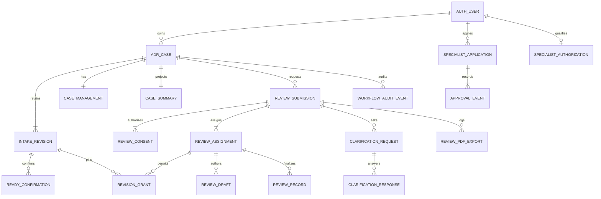

# ADR-1B Phase 3 proposed data, API and authorization contracts

**2026-11-08 Stage 3C-A:** [redesigned profile/dashboard and real hosted revoked-state verification](3c-a-implementation-and-verification.md) pass. The separately approved 3B administrator gate is closed. Sharing/assignment/review remain unimplemented and require their own policies. [Next 3C-B prompt](3c-b-next-prompt.md). Older checkpoint statements below retain historical scope.

**2026-11-08 implementation update:** [Phase 3B delivery and remaining live gates](3b-implementation-and-verification.md) records the actual identity/application/admin contracts, approved 30-day fictional policy, applied migration and fixture evidence. Administrator bootstrap and privileged hosted browser verification remain blocked. Earlier proposal text below does not override the implemented contracts or authorize Phase 3C. [Gated Phase 3C prompt](3c-next-implementation-prompt.md).

Reconciled supporting source from the interrupted planning session. The [master blueprint](../../architecture/ADR_PHASE3_MASTER_BLUEPRINT.md) owns the expanded stage boundaries.

**Design only, 2026-11-07.** No object or endpoint below has been created.
Read the [requirements and approval register](requirements-and-stages.md) first. P01-P17 references are approval gates, not assumed decisions.

## 1. Existing boundaries and compatibility

The existing patient namespace is `/api/account/adr-guided`.

- GET collection returns owner summaries; paginated queries accept limit/after.
- POST collection creates a fictional case with a required idempotency key in cloud mode.
- GET case returns the current snapshot, next question, missing checklist and warnings.
- GET case/history returns revision numbers with optional limit/before.
- POST case/command accepts expectedRevision and a typed intake command.
- POST case/pdf accepts expectedRevision and exports the latest saved revision only.

These contracts remain available. The new dashboard facade does not replace the guided intake service or reinterpret expectedRevision.

Current history listing does not expose arbitrary historical snapshots. Current PDF generation intentionally rejects stale latest-revision requests. Add explicit historical routes to support historical views; do not weaken those current checks.

Existing case identity is composite owner_id plus id. All new nested data must reference that ownership boundary. Browser roles cannot call existing protected mutation functions. The runtime writer has no direct protected-table write grant.

## 2. Logical schema proposal

These are reviewable object specifications, not executable migration SQL. Exact names may change during the authorized implementation review while preserving these invariants.

### Existing tables retained

- `auth.users` is the identity authority. Never create a parallel identity table.
- `public.patient_profiles` retains its current consent flags and profile revisions. These flags do not authorize specialist sharing.
- `apip_adr.cases` retains owner, case ID and current intake revision.
- `apip_adr.revisions` remains immutable and stores versioned intake snapshots.
- `apip_adr.pdf_exports` retains owner exports against an exact intake revision.

### Phase 3A objects

**case_management**

- owner_id UUID and case_id UUID form the primary/composite foreign key to cases.
- management_version BIGINT starts at 1 and increases on each management command. Serialize it as a decimal string in new JSON contracts.
- archived_at TIMESTAMPTZ nullable, archived_by UUID nullable and archive_reason_code nullable are consistent as a group.
- latest_ready_confirmation_id UUID nullable references a receipt belonging to the same owner/case.
- Lifecycle metadata is separate from clinical snapshots. No status column is written into historical JSON.

**case_ready_confirmations**

- id UUID primary key; owner_id, case_id, intake_revision identify the exact immutable snapshot.
- affirmation_version TEXT, affirmed_at TIMESTAMPTZ and command_id UUID are mandatory.
- The actor must be the owner. Immutable receipts remain after a new intake revision makes them stale.
- A composite foreign key binds owner/case/revision to revisions. A constraint prevents another case's receipt being selected as current.

**case_summaries**

- Primary key owner_id/case_id, latest_intake_revision INTEGER and source_updated_at TIMESTAMPTZ.
- Confirmed case_type is nullable with Initial/Follow-up values; reported_date DATE is nullable.
- Confirmed medicine names are a bounded array; a deterministic search document contains only approved summary fields.
- No raw narrative, profile history, rejected proposal or clinical conclusion is indexed.
- Index owner_id/source_updated_at/case_id and owner_id/created_at/case_id; evaluate a GIN medicine search document in fixtures with realistic owner counts.
- Summary updates run transactionally for every intake save, including existing clients. A tested revision-insert projection trigger or equivalent existing-function extension covers all entry points.
- The summary is derivative. A revision mismatch is detected, not silently presented as current. A bounded owner-only snapshot fallback or explicit degraded response is specified before implementation.

**case_deletion_requests**

- id UUID, owner_id/case_id composite FK, requested_at, request_version and bounded reason_code.
- Proposed states REQUESTED, ACKNOWLEDGED, CANCELLED. No state claims permanent erasure.
- Append immutable request events. No hard-delete function, cascade purge or automated erasure job is part of Phase 3.
- P08/P09 decide handlers and retention.

**workflow_command_receipts**

- Unique actor_id/operation_scope/idempotency_key.
- Store target identifiers, canonical request hash, receipt version and minimal result reference.
- No complete patient narrative in receipt metadata.
- Exact retries are replayed without repeating transitions; same key with a different body conflicts.
- Revalidate current access before returning a stored result. A receipt is not a capability.

**workflow_audit_events**

- id UUID, occurred_at TIMESTAMPTZ, actor_id UUID, actor_capability, event_type, owner_id/case_id and optional submission/assignment/review identifiers.
- Include source_revision, prior/new state codes, capability/grant version, outcome, reason_code, request_id and command_id where applicable.
- Append-only for ordinary application roles. Audit readers and retention are separately approved.
- No credentials, tokens, raw notes, medical narratives or proof documents in operational/audit metadata.
- Deletion of an Auth identity cannot cascade-delete audit or ADR data. Existing FK restrictions remain effective.

### Phase 3B objects

**specialist_applications**

- id UUID, applicant_user_id UUID FK auth.users, application_version BIGINT.
- Bounded profession/jurisdiction/registration-reference fields, verification_reference and application timestamps.
- Store references to approved independent checks, not unapproved credential uploads.
- An applicant edits only permitted pending application fields through a command function. Approval fields are never applicant-writable.
- Only one active application per applicant; rejected/resubmitted applications retain history.

**specialist_approval_events**

- Immutable id UUID, application_id, subject_user_id, decision, reason_code, decided_by, decided_at, evidence_reference and policy_version.
- Require subject_user_id != decided_by.
- Decisions map to PENDING, APPROVED, REJECTED, SUSPENDED, REVOKED or EXPIRED effective states as approved.
- Historical decisions are not overwritten.

**specialist_authorizations**

- user_id UUID primary/FK, effective_state, valid_from, valid_until, authorization_version BIGINT and latest_approval_event_id.
- Database predicates require approved, valid and unsuspended state using server/database time.
- No JWT or user_metadata field is authoritative for professional authorization.

**administrator_capabilities**

- user_id UUID, capability TEXT and capability_version BIGINT form the controlled grant record.
- Bounded grants such as specialist.verify and specialist.approve; no implicit case.read capability.
- Explicit grant/revoke metadata and audit references.
- Initial grants require a named authorized operator and approved out-of-band provisioning procedure. No public endpoint grants the first administrator.

### Phase 3C objects

**review_consents and review_consent_events**

- Consent id UUID, owner_id/case_id, recipient_specialist_id UUID, disclosure_scope_version, wording_version and source_intake_revision.
- Immutable event receipts record grant, withdrawal and supersession; an effective projection supports current authorization.
- Grant events bind recipient, revision and scope, with actor and timestamp.
- Withdrawal sets an effective end for future access; it does not erase delivered bytes or audit history.
- Composite FKs prevent consent for one case authorizing another. Profile-sharing flags cannot satisfy this FK.

**review_submissions**

- id UUID, owner_id/case_id, initial_source_revision, created_by, submitted_at, submission_version BIGINT and state.
- State is SUBMITTED, IN_REVIEW, NEEDS_INFORMATION, REVIEWED or WITHDRAWN.
- A submission must reference active explicit consent and an eligible recipient at creation.
- Retain closed episodes. A new consented episode receives a new ID.
- Proposed one active episode per case is enforced with a partial unique constraint after P04 approval.

**review_assignments**

- id UUID, submission_id, specialist_id, assignment_epoch BIGINT, assigned_at, revoked_at, reason_code and assigned_by.
- One active assignment per submission under the proposed policy.
- The composite relationship requires the consent recipient and assignment recipient to agree.
- Reassignment atomically revokes the previous assignment, ends its grants, records an event and creates a new epoch under fresh consent.
- An authorization record alone never creates an assignment.

**review_revision_grants**

- Composite submission_id/assignment_id/assignment_epoch/intake_revision plus owner/case FK.
- Reference the approved consent receipt for that exact revision.
- Grant rows are explicit; there is no open-ended latest_revision wildcard.
- Effective access also requires current approval, live assignment, consent and non-withdrawn episode.

**review_drafts and review_records**

- Draft key submission_id/assignment_id/author_id with draft_version BIGINT.
- Proposed fields include completeness observations, chronology observations, clarification items and plain-text review summary. Final approved fields depend on P16.
- Draft visibility follows P10; proposed default is author-only until finalized.
- Final records have id UUID, exact source_intake_revision, assignment_epoch, author_id, finalized_at, schema_version and immutable structured content.
- Amendments add a new record with supersedes_review_id from the same authorized episode. They do not rewrite the prior record.
- There is no automatic causality score, medication recommendation or synthesized signature field.

**clarification_requests and clarification_responses**

- Request id UUID with submission/assignment/source_revision, authored_by, version and bounded field-key/question entries.
- Patient response links a new immutable intake revision and an explicit share-update consent/grant receipt.
- Draft responses are not shared automatically.
- A request cannot grant blanket access to all later patient revisions.

**review_pdf_exports**

- id UUID, actor_id, submission/assignment/epoch, owner/case/source_revision, template hash, artifact hash, byte length, outcome and timestamp.
- Separate from patient export receipts because the current owner export function derives auth.uid as owner.
- The specialist remains the authenticated transaction subject. Never impersonate a patient to call record_pdf_export.
- Private generated bytes follow existing bounded generation and cleanup rules. No public Storage bucket is introduced.

### Relationship diagram



The diagram summarizes logical relationships. Required/optional cardinality must be reconciled with approval choices and the actual DDL review. It does not imply these objects exist.

## 3. Authorization design

### Effective access rule

Patient reads require verified actor == case owner. Specialist reads require all of the following at the time of access:

1. A verified Supabase subject and an active professional authorization.
2. Active assignment to that same subject and current assignment epoch.
3. Active patient consent for that recipient and permitted disclosure scope.
4. An explicit revision grant for the requested owner/case/revision.
5. A permitted episode state and approved operation capability.

A workspace tab, UUID in a request, registration field, user_metadata claim, old JWT role or command receipt is insufficient.

### Patient capability

Anonymous callers have no patient, application, assignment, review or audit read/write capability. A signed-in applicant has only their own application/status capability until independently approved. Pending or revoked specialist identity never broadens ordinary patient ownership access.

May list/load/edit own current intake and read own historical revisions. May create own ready/consent/archive/deletion-request events under approved policies. May read patient-visible finalized review records. Cannot modify professional approval, assignments outside the approved patient selection flow, audit or finalized reviews.

### Specialist capability

May read its own application and active assignments. May read only authorized projected revisions/PDFs. May write its own permitted review drafts, clarification requests and final review commands. Cannot mutate patient snapshots, administrative grants, consent or unrelated reviews. Specialist PDF download is denied until P14 approval.

Authorship alone does not preserve access after revocation. Retained professional drafts/records remain subject to approved assignment/consent rules. Patient access to finalized patient-visible records after withdrawal is a separate owner view governed by P09/P10, not restoration of specialist permission.

### Administrator capability

May act only through approved identity/authorization functions. No default permission to read narratives, export reports or participate in review. Approval requires independence from the applicant. Clinical case access, if ever required, is a separate recorded grant.

### Database access boundary

Keep the existing owner-only policies on patient cases/revisions. Do not add a blanket authenticated-specialist policy to the raw snapshot table.

Proposed specialist reads use audited functions in a private schema and return only the shared projection. A narrow NOLOGIN function-owner role such as apip_review_reader gets selected snapshot columns and a separate role-targeted RLS policy requiring the exact active revision grant. It has no table ownership, BYPASSRLS or patient-write rights. The runtime writer can EXECUTE approved reader functions but cannot SET ROLE to that internal role or directly acquire its grants.

A narrow workflow function-owner role may insert/update only approved workflow objects under actor-aware RLS. Identity-approval functions use a separate role with no case narrative privileges. Exact grants and recursive-policy avoidance must be reviewed/tested before migration approval.

Every privileged function uses a fixed empty search_path and fully qualified references, validates auth.uid and the target relationship, accepts no caller-selected actor/role/owner override and avoids dynamic SQL. Revoke default PUBLIC execution. Browser anon/authenticated roles receive no execution grants on these trusted API functions. The existing restricted writer gains only exact needed EXECUTE grants.

New exposed tables receive RLS before any grant. Prefer private workflow schemas with no direct browser access. For every permitted UPDATE include both USING and WITH CHECK and prevent reassignment of owner, author, recipient or source revision. Unique/composite FKs enforce nested ownership independently of API filters.

Audited specialist read functions atomically write a required access event before returning a projection. Reader functions must be owned by roles with only the specific read/audit privileges they require. Policy helpers must avoid recursion and arbitrary-UUID enumeration. These details are implementation review gates, not permission to add SECURITY DEFINER to bypass an error.

### Revocation and race handling

Do not cache professional authorization beyond the approved revocation policy. Proposed initial behavior reads current database authorization on each request.

Use one documented lock order across role changes, case workflow, assignment and review commands. Suggested order is ordered authorization/grant subjects, existing case advisory lock, management row, submission, assignment and review draft. Final order must be exercised with deadlock/race fixtures, including current append_revision locks.

Submission creation also acquires the current case lock used by intake saving before checking the exact revision. If an intake edit wins first, submit conflicts. If submission wins first, later edits become unshared revisions while the original shared snapshot remains stable.

Revocation takes effect at its committed authorization boundary. Every later request and final PDF delivery check consults current state/versions. An operation already delivered before that boundary cannot be recalled. A concurrent operation either commits under the authorized ordering or fails safely; it cannot attach its result to another assignment epoch.

Idempotent replay rechecks current actor/capabilities first. It returns an operation receipt plus current state, so an old successful response cannot silently undo later withdrawal or reactivation rules.

## 4. Proposed API conventions

New namespaces are illustrative contracts, not live endpoints.

All protected requests use the existing verified bearer middleware and account-switch guard. Identity is derived server-side. Never accept owner_id or actor_id as authority in a write body.

New mutations require Idempotency-Key UUID plus explicit relevant versions. Intake expectedRevision remains a number. New BIGINT management/submission/draft/authorization versions are decimal strings. Validate exact body keys and reject unknown role/owner/approval fields.

Success responses return resource, current versions, allowed actions and an operation receipt. Capabilities describe current permitted actions and never replace server checks. A denied or stale action does not mutate any resource.

Errors are bounded JSON with error code and request reference, without narratives or foreign-resource metadata.

- 400 for malformed syntax, cursor or unsupported fields.
- 401 for missing, expired or revoked identity.
- 403 for an authenticated user lacking a workspace/administrator capability.
- 404 for a resource not visible to the actor.
- 409 for version, idempotency, workflow or assignment conflict.
- 422 for a semantically invalid new workflow transition or missing approved prerequisite.
- 429 for bounded rate/concurrency limits.
- 503 for unavailable dependencies or failed required audit persistence.

Preserve existing endpoint status behavior instead of silently normalizing old clients to the new namespace.

## 5. Phase 3A patient contracts

### GET /api/account/adr-cases

Parameters are limit 1..50; cursor; q; status; caseType; medicine; dateField; from; to; sort; direction; archived.

- q searches approved case reference/confirmed medicine fields with bounded normalized input.
- dateField is created, updated or reported. Timestamp filters use inclusive UTC from and exclusive UTC to; reported filters use calendar dates.
- sort is created_at or updated_at initially. direction is asc/desc. Null reported dates have explicit behavior.
- status uses the display-status definition in the requirements, with underlying intake/review status returned separately.
- Cursor encodes version, canonical filter/sort digest, last sort value and case ID. It is not authorization. Reapply actor ownership after decoding and reject a filter/sort mismatch. Never use a cursor-supplied owner.
- Apply filters before limit. Do not fetch one page and filter in the browser.
- Response items contain caseId, latestIntakeRevision, managementVersion, createdAt, updatedAt, caseType, confirmedMedicineNames, intakeStatus, reviewStatus, reviewSourceRevision, hasUnsharedChanges, archivedAt and allowedActions.
- Return nextCursor. Counts, if later added, must be owner-scoped and bounded.
- Summaries exclude full reaction narrative and profile data.

### GET /api/account/adr-cases/:caseId

Returns owner detail, versions, review-episode summaries and current permitted actions. Fetch full current intake through the existing guided contract when opening the editor. A specialist cannot use this owner endpoint.

### GET /api/account/adr-cases/:caseId/revisions

Returns paginated immutable revision descriptors. Preserve the existing history endpoint. Sort by revision descending and validate limit/before.

### GET /api/account/adr-cases/:caseId/revisions/:revision

Loads the exact owned snapshot with readOnly true and source labels. It does not copy that old state over the latest case. Original statements and proposals retain their distinct labels for the owner.

### POST /api/account/adr-cases/:caseId/revisions/:revision/pdf

Explicit historical export from the exact owned immutable revision. Returns application/pdf, attachment filename, X-APIP-Revision and no-store. Record the selected revision and template hash. Recheck identity/ownership before sending. Do not run the current latest-only recheck against a deliberately selected historical revision; preserve that recheck on the existing current PDF route.

### POST /api/account/adr-cases/:caseId/lifecycle

Envelope example:

```json
{
  "expectedIntakeRevision": 12,
  "expectedManagementVersion": "4",
  "command": {
    "type": "mark_ready",
    "affirmationVersion": "patient-confirmation-v1",
    "accepted": true
  }
}
```

Proposed commands are mark_ready, return_to_draft, archive and restore. Corresponding policies must be approved before a command is enabled. The server verifies current snapshot, confirmation and eligibility in one transaction. A subsequent intake save makes a revision-bound ready receipt inapplicable without rewriting it.

### POST /api/account/adr-cases/:caseId/deletion-requests

Records an approved request with expectedManagementVersion and a bounded reasonCode. Return a request reference and a precise pending state, never a deletion-complete response. Cancellation/acknowledgment use versioned commands restricted by approved policy.

There is no new permanent DELETE contract.

## 6. Phase 3B identity contracts

### GET /api/account/capabilities

Returns effective workspace capabilities and authorizationVersion from authoritative database state. It does not return confidential verification evidence or administrator provisioning secrets.

### POST /api/specialist/applications

Creates the actor's own application from approved minimal fields. Requires idempotency. A role/status/approvedBy field in the body is rejected.

### GET /api/specialist/applications/current

Returns only the applicant's own application, version and patient-safe decision reason. Professional verification outcome is not inferred from email verification.

### POST /api/specialist/applications/:applicationId/commands

Pending editable details or withdrawal/resubmission under P03. Must match the current applicant and application version; cannot set approval state.

### GET /api/admin/specialist-applications

Approved identity administrators only, paginated. No patient clinical records are included.

### POST /api/admin/specialist-applications/:applicationId/decisions

Requires current approve capability, independent approver, expectedApplicationVersion, expectedAuthorizationVersion, decision, bounded reasonCode, approved evidenceReference and policyVersion. Atomically append the decision, update effective authorization and audit. Grant/revoke administrator capabilities remains an out-of-band controlled procedure initially.

## 7. Phase 3C patient review contracts

### GET /api/account/adr-review-recipients

Returns only the minimum public directory fields for currently approved eligible specialists. No private license evidence, contact addresses or unrelated applicant records. Whether a directory is appropriate requires P04.

### POST /api/account/adr-cases/:caseId/review-submissions

Requires current intake/management versions, sourceRevision, recipientSpecialistId, disclosureScopeVersion, consentWordingVersion and accepted true. Server checks readiness, exact owner/revision, eligible recipient, no prohibited self-review and approved scope. Creates consent, submission, assignment, revision grant and audit atomically.

### GET /api/account/adr-cases/:caseId/review-submissions

Returns only the owner's episodes, patient-visible notes, clarification requests and exact shared-revision descriptors.

### POST /api/account/adr-review-submissions/:submissionId/commands

Versioned commands withdraw, publish_update and request_reassignment. publish_update requires a named new source revision and explicit consent wording acceptance. Reassignment requires a newly eligible recipient and new recipient-specific consent. Existing assignee grants are not copied silently.

## 8. Phase 3C specialist contracts

### GET /api/specialist/assignments

Paginated current actor assignments filtered by approved state and effective grants. No global patient search.

### GET /api/specialist/reviews/:submissionId

Returns the authorized shared projection and review state, assignment epoch, versions and permitted actions. Never returns raw patient profile, unconfirmed proposals or ungranted revisions.

### GET /api/specialist/reviews/:submissionId/revisions

Returns only explicitly granted revisions for the current active assignment. The complete patient history remains outside the response.

### GET /api/specialist/reviews/:submissionId/revisions/:revision

Returns the authorized projection for the exact granted revision and writes the required access audit event.

### POST /api/specialist/reviews/:submissionId/revisions/:revision/pdf

Requires expectedSubmissionVersion and assignmentEpoch. Generates the original PvPI form for that authorized source revision, rechecks current authorization after generation and records a specialist export receipt. Return no bytes when the grant changed or required audit persistence failed. Preview access is not a guarantee against copying. Download capability follows P14.

### POST /api/specialist/reviews/:submissionId/commands

Every command binds expectedSubmissionVersion, assignmentEpoch and sourceRevision.

- start_review moves the assigned episode into active review.
- save_review_draft also requires expectedDraftVersion and the approved plain-text structured fields.
- request_information creates bounded field-key/question items against the shared revision.
- finalize_review requires the current draft version, exact source revision and an explicit human affirmation.
- amend_review appends an approved superseding record; it cannot modify patient snapshots or the finalized record.
- decline_assignment behavior and reassignment authority require P04/P11.

### GET /api/account/adr-cases/:caseId/access-history

Proposed optional patient-visible audit projection under P15. Return minimal actor display/capability, access type, source revision and time; never expose security internals, unrelated records or privileged verification data.

## 9. Transaction, consistency and audit invariants

- All mutations and their required audit/receipt rows commit atomically.
- A specialist role change does not change case ownership.
- A revoked assignment cannot be used to replay a cached sensitive read or command response.
- Lock/permission checks consult current state before using an immutable snapshot.
- Review drafts are optimistic mutable records; finalized reviews and patient snapshots are immutable.
- A consent grant does not authorize every historical or future revision.
- An intake edit does not silently update the snapshot under professional review.
- PDF cache keys bind identity, case, revision and applicable grant/assignment versions. Final checks precede response bytes.
- audit-required reads fail closed if their audit transaction fails.
- Reconnect/retry cannot duplicate consent, assignment, review finalization or audit command receipts.
- Readiness endpoints and operational logs expose dependency status and request IDs, never narrative content.
- No current report is automatically submitted, reviewed, archived or shared during migration.

### Audit vocabulary

Proposed event types include case.ready_confirmed, case.archived, case.restored, deletion.requested, deletion.cancelled, specialist.applied, specialist.approved, specialist.rejected, specialist.suspended, specialist.revoked, specialist.expired, consent.granted, consent.withdrawn, assignment.created, assignment.revoked, assignment.reassigned, review.opened, revision.viewed, pdf.previewed, pdf.downloaded, clarification.requested, clarification.shared, review.finalized and review.amended.

Permission-changing commands record reason and prior/new authorization versions. Denied access logs use sanitized identifiers/outcomes under approved retention. Audit metadata never contains credentials or copied clinical text. Successful command events are deduplicated by receipt; separate read attempts may legitimately produce separate access events.

## 10. Migration and deployment-mode plan

1. Review existing ledger and checksums without replaying baseline migrations.
2. Create future additive versioned migration files only after stage implementation and policy approval.
3. 3A adds management/ready/search/request/audit objects, indexes and transactional projection support. Backfill bounded batches from owner-scoped current snapshots. All existing cases start with no ready confirmation and no review consent.
4. 3B adds identity applications/authorizations/admin capabilities and exact function grants. No real privileged identity is bootstrapped without the named operator's approved procedure.
5. 3C adds consent/submission/assignment/review objects and reviewed RLS/functions. Use a feature capability that stays disabled until migration, policy and authorization tests pass.
6. Test fresh apply, repeat migration runner behavior, prior-schema compatibility, interruption rollback and backup/restore in disposable fixtures.
7. Never rewrite immutable baseline snapshots or silently link accounts by email. Keep owner IDs and source statements unchanged.
8. Reconcile parent/child composite FKs, actor immutability, UPDATE USING/WITH CHECK, function ownership and EXECUTE grants under actual runtime roles.
9. Deploy compatible API code only after schema readiness. Rollback disables new routes and preserves new records; do not drop populated tables or edit migration history to roll back.
10. Hosted development apply requires explicit authorization. No public release follows from passing the tests.

Phase 3A patient features should preserve SQLite development parity under P17 using additive versioned local migrations and the same repository/service contracts. Do not add production startup CREATE TABLE loops. Specialist identity/review is proposed as cloud-only; local mode reports those capabilities unavailable and never falls back to local accounts after a cloud failure.

## 11. Contract acceptance checklist

- Existing patient callers continue to work with unchanged intake/PDF semantics.
- Every new route has owner/capability/assignment/consent/version tests.
- Every nested FK preserves owner/case/revision linkage.
- Browser roles cannot mutate approval, consent grants, audit or finalized notes directly.
- New definer functions have explicit ownership, search_path, actor checks and exact EXECUTE grants.
- Role revocation and consent withdrawal take effect without waiting for JWT refresh.
- Every selected historical/PDF revision is unambiguous and independently verifiable.
- Pending policy decisions disable affected writes at both API and UI.
- All fixture and hosted tests are labeled according to what actually ran.
