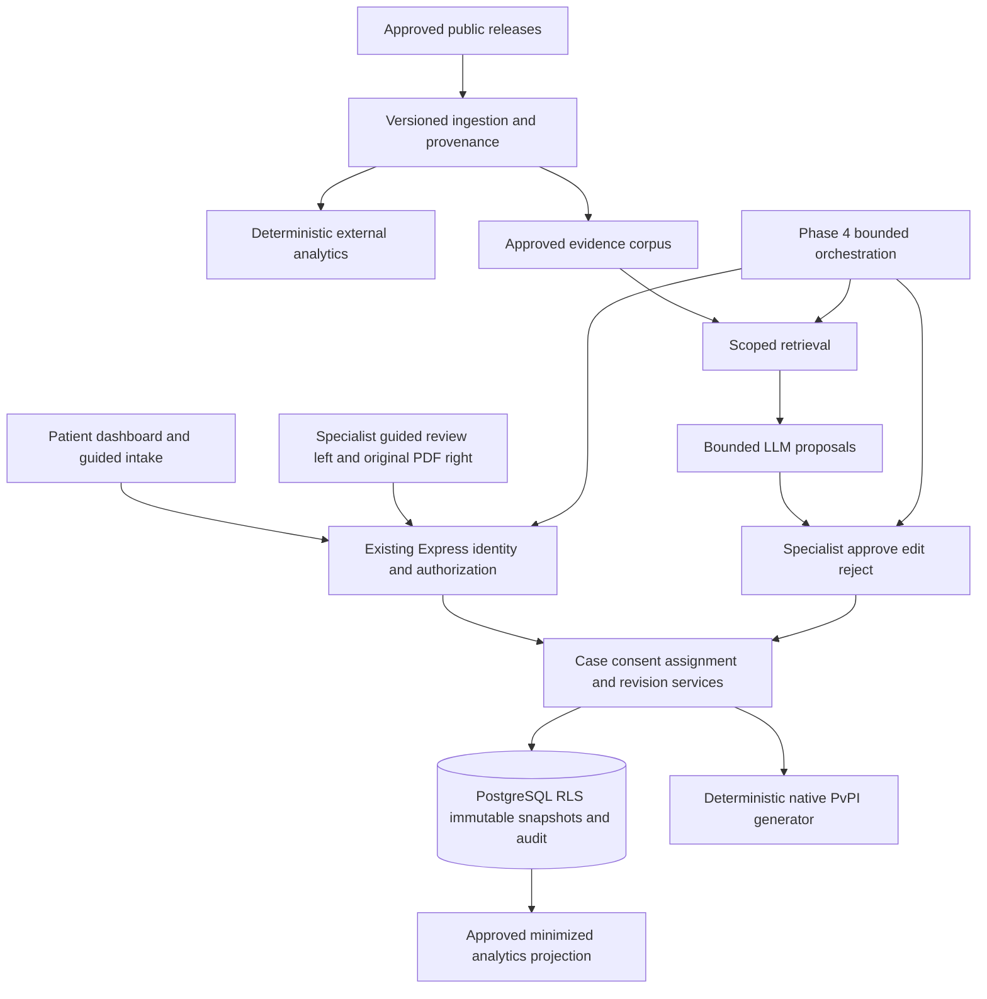

# APIP ADR Phase 3–4 master blueprint

**Canonical planning source — 2026-11-07.** The [authorized 3A owner dashboard/history/PDF subset](../adr/phase3/3a-implementation-and-verification.md) is implemented and separately verified. Lifecycle writes and later stages below remain proposed.

APIP means Agentic Pharma Co-intelligence Platform. The public-facing vision is a future product direction. Current engineering scope remains private, fictional and nonclinical.

## Authority and reconciliation

Baseline is codex/apip-postgres-foundation at 5c20ede3b9a2548646674e15a3d22914f4865a4e. [Actual backend evidence](../../database/hosted-verification-2026-11-07.md) records Auth, ownership, immutable revisions, recovery, natural expiry and native PvPI results. This planning task makes no new runtime-verification claim.

[Planning index](../adr/phase3/README.md) identifies the source for each concern. Three interrupted-session documents were preserved as detailed 3A–3D requirements, role/data/API contracts and stage prompts. Their useful content is reconciled; the expanded stage definitions here supersede earlier whole-phase AI exclusions.

Proposed allocation preserves 3A patient management, 3B specialist approval, 3C assignment/review and 3D integration testing. It adds 3E analytics, 3F public evidence/question suggestions and later Phase 4 orchestration. These ADR-1B stage names are distinct from older ADR-2/3/4 agent-roadmap labels.

## Product vision and hard boundaries

The product combines patient reporting/case management, independently verified pharmacovigilance specialists, explicit revision-bound submission/assignment, guided professional review with actual PvPI preview, internal/external analytics, approved public evidence retrieval, specialist-approved question suggestions and later governed agents.

- Private drafts never enter a shared queue or analytics cohort by default.
- Registration, workspace selection, confirmed email and user-editable metadata confer no professional privilege.
- Consent specifies recipient, scope and exact saved revision. Assignment and current professional approval are independently required.
- New edits stay unshared until explicit patient publication.
- Patient statements/confirmed fields, professional records and AI suggestions stay separate.
- Patient revisions and finalized professional records are immutable; amendments append.
- AMC/NCC-only fields and signatures require separate appropriate authorization. No authority is inferred from specialist registration.
- Internal APIP review never implies government submission or receipt.
- AI outputs and associations support evidence review, without clinical causality decisions or drug recommendations.
- MedAssist and sealed research remain unchanged. No real patient data or public deployment is authorized.

## Proposed architecture

Reuse Supabase Auth, the restricted writer, strict TLS, bounded pooling, transaction-local subjects, repositories, current guided interface and original template. Do not create a second identity system. Keep patient owner endpoints separate from projected specialist review endpoints.

Current history APIs return revision numbers; historical snapshot viewing needs an explicit new owner endpoint. Current PDF generation requires the latest revision; historical and shared-review exports need separate exact-revision contracts while retaining current stale-preview checks.

A trusted API can set database identity. RLS does not protect against compromise of that trusted boundary. Keep credentials server-only, verify every actor, use narrow function roles and audit required accesses.

## Stage ledger

The [acceptance matrix](../adr/phase3/acceptance-matrix.md) defines exact scope, dependencies, screens, database/API proposals, risks, tests, acceptance and exclusions for every stage.

1. **3A** builds the owner case dashboard and approved lifecycle metadata. Existing intake, Unknown/provenance semantics and PDF mappings remain reusable.
2. **3B** establishes independently verified specialist identity and administrator-controlled capabilities. Approved identity with no assignment has no patient access.
3. **3C** enables explicit submission, controlled assignment, pinned revision grants and human review. Desktop review is guided on the left with the real original PDF on the right.
4. **3D** is the security/integration gate for 3A–3C. It adds no product feature by default.
5. **3E** enables separately authorized internal metrics and versioned external descriptive analytics.
6. **3F** enables approved public retrieval and privately proposed follow-up questions requiring specialist disposition.
7. **Phase 4** may orchestrate already approved actions through finite workflows, explicit human checkpoints and bounded tools/budgets.

3E/3F have their own acceptance gates after 3D. Phase 4 depends on stable approved underlying tools; no generic agent engine is installed in Phase 0.

## Consent, queue and revision model

[Roles and contracts](../adr/phase3/roles-consent-and-revisions.md) owns logical schema, endpoint proposals, capability rules and transaction invariants. [Patient](../adr/phase3/patient-journey.md) and [specialist](../adr/phase3/specialist-journey.md) own screen flows.

Patient intake state and professional review state are separate. A reviewed revision followed by new edits cannot label those new edits Reviewed. Show the shared source revision and an additional New changes not shared badge.

Default queue proposal is assigned-only visibility. A shared dispatcher queue may be proposed only after an approved routing policy. It must not disclose drafts, names, contacts, narratives, medicines or PDFs to unassigned specialists. Queue metadata and claiming privileges require explicit approval.

Withdrawal/reassignment revokes future access under a defined transaction boundary. Previously delivered bytes cannot be recalled. Archive is reversible metadata; a deletion request does not erase records. No permanent deletion is included.

## Approval register extension

The preserved [P01–P17 decisions](../adr/phase3/requirements-and-stages.md#6-approval-register) cover readiness, human verification/approval authority, consent, assignment, notes, retention, revocation and local parity. All unresolved choices remain unapproved.

- **P18** Who may use internal analytics, which cohorts/consents qualify, and what suppression/differencing/export rules apply? No small-cell threshold is invented.
- **P19** Which exact source releases, rights/licenses, vocabularies, jurisdictions, freshness and withdrawal rules are approved?
- **P20** Which model/provider may receive which minimized data under what hosting, logging, retention, cost and human-review controls?
- **P21** Which exact agent actions, budgets, approvals, cancellation and compensation rules are authorized?
- **P22** Is routing patient-selected or dispatcher-based? What minimal queue metadata may an unassigned actor see? Proposed default is no unassigned patient visibility.

Professional verification requires a named qualified human procedure; this blueprint does not claim that any person has been credentialed. Real-data handling, public release and regulatory integration require separate authorization.

## Implementation and next step

Read-only planning does not authorize the proposed schemas or APIs. Implement one separately authorized stage at a time, first in disposable fixtures, then an explicitly authorized development project. No runtime schema creation or replay of applied migrations.

The [complete 3A implementation prompt](../adr/phase3/implementation-prompts.md#phase-3a) reuses the verified architecture and gates lifecycle writes on approved policies. Commit/push of this documentation is authorized; future application work and its Git actions follow that task's explicit authorization. Preserve draft PR 6 unmerged.
