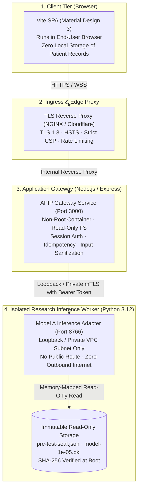
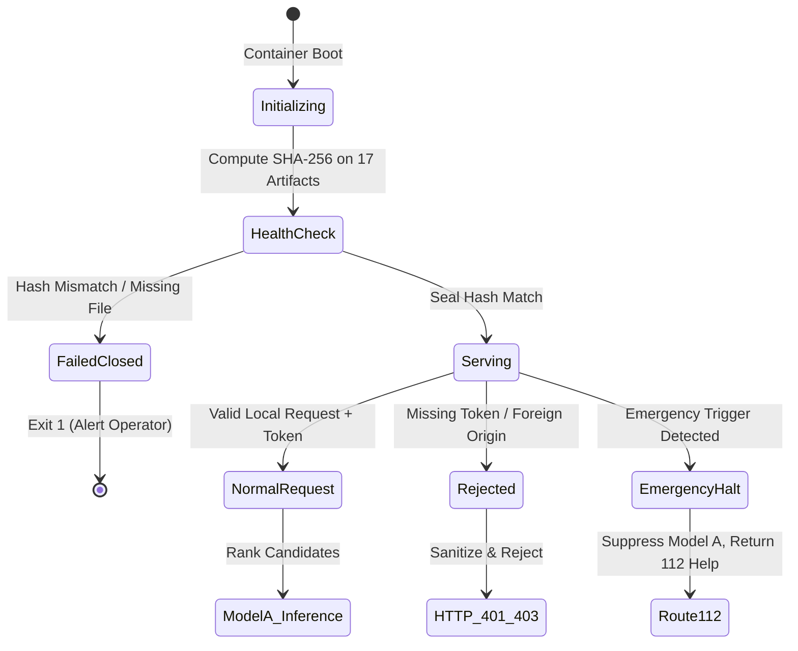

# APIP MedAssist — Secure Deployment Architecture & Configuration Plan

## 1. System Overview & Scope

This document specifies the target production deployment architecture and security configuration plan for the **Agentic PharmaCo Intelligence Platform (APIP) MedAssist** system.

> [!IMPORTANT]
> This is a planning and architecture specification. Per project constraints, **no cloud resources or production instances are deployed automatically**. Real-world patient deployment remains gated behind human clinical sign-off (Mahesh P) and locked test cohort validation (Phase A2.4).

---

## 2. Multi-Tier Isolated Topology

The recommended deployment architecture partitions MedAssist into four isolated layers separated by strict network and access boundaries:



---

## 3. Tier Security Specifications

### Tier 1: Client Tier (Single Page Application)
* **Static Asset Delivery:** Static build bundles (`dist/`) served with immutable content hashes and `Cache-Control: public, max-age=31536000, immutable`.
* **Zero Patient Data Persistence:** Fictional conversation history, symptoms, severity, and navigation contracts reside exclusively in browser page memory (`React.useState` / `useRef`). Refreshing or closing the tab zeroes all in-memory state.
* **Content Security Policy (CSP):**
  ```http
  Content-Security-Policy: default-src 'self'; script-src 'self'; style-src 'self' 'unsafe-inline'; font-src 'self'; img-src 'self' data: https://maps.googleapis.com; connect-src 'self'; frame-ancestors 'none'; form-action 'self';
  ```

### Tier 2: Ingress & Edge Proxy
* **Transport Security:** Minimum TLS 1.3, strict cipher suites, HTTP Strict Transport Security (`HSTS: max-age=31536000; includeSubDomains; preload`).
* **Rate Limiting:** IP-based and session-based token bucket:
  * Maximum 6 requests/minute for language extraction (`/extract`).
  * Maximum 30 requests/minute for general navigation (`/interview`).
  * Automatic `429 Too Many Requests` with RFC 7231 `Retry-After` headers.

### Tier 3: Application Gateway (Express / Node.js 24)
* **Process Sandboxing:** Runs in an unprivileged Linux container (`user: node`, UID 1000) with a read-only root filesystem (`readOnlyRootFilesystem: true`).
* **Origin & Host Protection:** Strictly validates HTTP `Host` and `Origin` headers (`trustedLocalRequest`). Cross-origin browser requests are rejected with HTTP 403.
* **Token Guard:** Internal communication with Tier 4 requires an environment-injected operator token of 32–256 characters (`MEDASSIST_A_TOKEN`), transmitted via `Authorization: Bearer <token>` and validated using timing-safe comparisons (`hmac.compare_digest`).
* **Emergency Safety Precedence:** Synchronous pattern matcher (`evaluateStatement`) intercepts input before any model inference slot is allocated. Identified emergency signs trigger immediate escalation (`emergency_referral`) and halt conversational questioning.

### Tier 4: Isolated Inference Worker (FastAPI / Python 3.12)
* **Network Isolation:** Bound strictly to loopback (`127.0.0.1:8766`) or a private Unix domain socket / isolated VPC subnet. **Zero egress (no outbound internet connection permitted).**
* **Cryptographic Boot Authentication:** At container startup, `campaign_loader.py` computes SHA-256 digests of all 17 sealed run artifacts and compares them against `pre-test-seal.json` and `pre-test-seal-hash.json`. Any modified or missing byte causes startup to fail closed with HTTP 503 (`artifact_unavailable_or_integrity_failed`).
* **Defense-in-Depth Pickle Restriction:** Deserialization uses `_RestrictedModelUnpickler`, allowing only pure mathematical primitives:
  * `sklearn.linear_model._stochastic_gradient.SGDClassifier`
  * `numpy._core.numeric._frombuffer` / `numpy.core.numeric._frombuffer`
  * `numpy.ndarray`, `numpy.dtype`, `numpy._core.multiarray._reconstruct`
  * `sklearn._loss._loss.CyHalfBinomialLoss`
  Any attempt to unpickle arbitrary objects or callable scripts triggers immediate rejection.
* **Thread & Resource Boundaries:** CPU threadpool strictly locked to single-threaded matrix operations (`threadpool_limits(limits=1)`). Memory footprint is bounded to under 120 MB RAM.

---

## 4. Cost Ceiling & Hardware Budget Compliance

The platform operates under a confirmed **INR 500 (~$6 USD) monthly operational ceiling**:

| Resource | Target Deployment Spec | Estimated Monthly Cost |
| :--- | :--- | :---: |
| **Edge & Compute** | Shared single vCPU (0.5–1.0 vCPU, 1 GB RAM container, e.g. Railway / Hetzner / Fly.io hobby tier) | ~INR 350 – 420 |
| **Bandwidth** | Cloudflare Free Tier (cached static assets, compressed JSON APIs) | INR 0 |
| **Model Inference** | Local CPU execution of Model A SGDClassifier (65,537 weights, ~0.8 ms inference latency per turn) | Included in Compute |
| **External APIs** | Google Maps Platform (within free monthly $200 recurring credit tier; bounded radius & caching) | INR 0 |
| **Total Estimated Spend** | **Within INR 500 planning envelope** | **Compliant** |

---

## 5. Environment Variables & Secret Configuration Plan

| Variable Name | Required By | Secret? | Description |
| :--- | :---: | :---: | :--- |
| `NODE_ENV` | Gateway | No | Must be set to `production` in live environments. |
| `APIP_ENABLE_MODEL_A_DEMO` | Gateway | No | Set to `1` in developer/research lab environments; `0` in public instances. |
| `MEDASSIST_A_TOKEN` | Gateway & Adapter | **Yes** | 32–256 character high-entropy token used for gateway-to-adapter mTLS / Bearer authentication. |
| `MEDASSIST_A_RUN_ROOT` | Adapter | No | Path to the directory containing sealed campaign artifacts. |
| `MEDASSIST_A_METADATA_ROOT` | Adapter | No | Path to source DDXPlus metadata directory (`release_evidences.json`). |
| `GOOGLE_MAPS_API_KEY` | Gateway | **Yes** | Optional Google Maps API key for live Places/Routes search. If omitted, falls back to simulated fixtures. |

---

## 6. Failure Modes & Operational Runbook



* **Health Probes:** Liveness probe on `GET /api/health`; readiness probe on `GET /api/research/model-a/natural/vocabulary`.
* **Zero Downtime Updates:** Rolling blue/green deployment; traffic shifts only after the new container passes SHA-256 seal verification.
