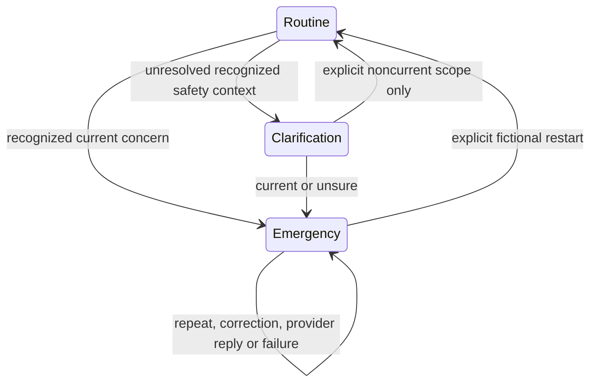

# Emergency recognition milestone — 2026-10-26

**NO-GO past the emergency-recognition safety gate, including beginning further Model B work under this milestone. Draft review only; do not merge or enable clinical use.** The original three emergency examples now escalate, but the separately authored, one-time heldout evaluation fails the predefined safety gates. Clinical Model B remains disabled. No fictional score is clinical sensitivity or proof of real-world safety.

## Audit, sources and implemented scope

The [pre-implementation audit](emergency-recognition-audit.md) found the original v1 shared catalogue had only emergency-help requests and literal inability-to-breathe phrases. Heart-attack and stroke declarations were absent. Its substring matcher had no independent assertion, subject, history or hypothetical interpretation. Existing interruption precedence was present; lexical/context coverage was the immediate cause of the two original misses. Broader extraction filters could suppress suspected/third-party evidence and were not suitable as emergency clearance.

The new `emergency-context.v2.0.0` shared JSON catalogue and deterministic TypeScript/Python engines attempt named/suspected cardiac and stroke emergencies, symptom-only cardiac/stroke warnings, severe breathing difficulty, unresponsiveness, major bleeding, anaphylaxis/airway swelling and explicit emergency-help requests. A separate ambiguity rule requests context. Each mention records subject, assertion, time/context and rule identity; no mention becomes confirmed Model A evidence or a diagnosis. Current/recent suspected emergencies are different from confirmed diagnoses. UNKNOWN and no-match are never negative safety findings.

Public source support was checked on 2026-10-26: [NHS heart attack](https://www.nhs.uk/conditions/heart-attack/), [chest pain](https://www.nhs.uk/symptoms/chest-pain/), [stroke](https://www.nhs.uk/conditions/stroke/symptoms/), [breathing](https://www.nhs.uk/symptoms/shortness-of-breath/), [anaphylaxis](https://www.nhs.uk/conditions/anaphylaxis/), [Resuscitation Council UK](https://www.resus.org.uk/professional-library/2025-resuscitation-guidelines/adult-basic-life-support-guidelines), [St John Ambulance bleeding](https://www.sja.org.uk/first-aid-advice/severe-bleeding/) and [India emergency services](https://www.mha.gov.in/en/commoncontent/emergency-response-support-system-erss). These sources support category proposals, not this regex implementation, a new clinical threshold or APIP clinical approval. The catalogue remains `provisional_unreviewed`, clinician reviewer null and clinical validation false. No treatment, medication, CPR procedure or personalized precaution is generated.

## State and integration boundaries

Clarification blocks ordinary model work without consuming a Model A question or inferring negative evidence. An established emergency advances the request generation, aborts pending work and latches guidance; stale or conflicting model replies cannot clear it. Explicit noncurrent clarification is not clearance. A fictional restart resets software state, not medical risk. Both conversation pages and Express/Python extraction boundaries use independent guards before providers. The eight-question application wrapper and frozen inference contract are unchanged. The UI reuses existing Material Web controls and layout; no redesign or CSS change.

Emergency guidance directs local emergency-service contact without waiting for the demo or Maps. India 112 is jurisdiction-labelled. No automatic call or location request occurs. Existing navigation remains a separate consented, location-only external Maps search, with no verified hospitals, distance, availability or suitability. Models offline, provider timeout, delayed/conflicting replies, denied location and navigation failures are engineering test conditions, not clinical evidence.

## Independent evaluation — failed

The [protocol](../evaluation/emergency-recognition-v2/protocol.json) was specified before implementation. A separately authorized AI evaluator authored and froze 100 English fictional cases before reading the implementation; the implementation author did not open the gold set until [implementation freeze](../evaluation/emergency-recognition-v2/implementation-freeze.json). The evaluator then called each engine once per case and preserved raw decisions and [immutable aggregate results](../evaluation/emergency-recognition-v2/heldout-final-results.json). This is independent AI authorship for engineering evaluation, not independent human clinical adjudication.

Gold actions: 72 escalate, 10 clarify, 18 not_assessed. Three-way confusion counts (columns: escalate / clarify / not_assessed):

- Gold escalate: **47 / 1 / 24**.
- Gold clarify: **3 / 4 / 3**.
- Gold not_assessed: **5 / 1 / 12**.

Primary binary denominator is 90, excluding ten gold-clarify cases. TP 47, FP 5, FN 25, TN 13; **recall 65.28%, precision 90.38%**. A clarify prediction on an emergency is an FN. A clarify prediction on gold not_assessed counts TN in binary but remains a three-way error. Exact three-way action agreement is 63/100. Three ambiguous cases permit ordinary continuation; three others escalate instead of clarifying. TypeScript/Python full decisions match 100/100: parity does not establish correctness.

Emergency true positives / cases by category: explicit cardiac 7/8; explicit stroke 7/8; cardiac warning descriptions 4/8; stroke warning descriptions 1/8; severe breathing 6/8; unresponsiveness 6/6; severe bleeding 3/6; anaphylaxis/airway 7/8; explicit emergency requests 2/6; urgent third party 4/6. Non-emergency false escalations: explicit negative/nonmatch 2/8, remote history 0/5, educational/hypothetical 3/5. The [independent evaluator report](../evaluation/emergency-recognition-v2/independent-evaluation-report.md) retains all 37 action failures, full fictional text and observed annotations, including subject errors. One other-person emergency has an incorrect self annotation; metadata correctness fails even though existing evidence-isolation tests pass. No evidence insertion is inferred from a metadata error alone.

Zero exact utterance overlap was found with the previous 115 cases or 43 new development cases. One normalized overlap exists: heldout `heart attack?` versus development `heart attack`. It is disclosed without editing gold or removing it from the prospective denominator. The old results, v1 catalogue and development evidence remain historical and unchanged. No implementation tuning or matcher rerun occurred after unblinding.

Failed gates: zero emergency FN, minimum 95% precision, zero ambiguity routine continuations and third-party subject correctness. Original-three recognition passes. Passing software regression does not supersede these failures. The [independent browser receipt](../evaluation/emergency-recognition-v2/independent-integration-results.json) executed the twelve separate scenarios once at 1440 px with wholly mocked API/location. Recognized triggers retained guidance through outage, timeout, conflicting late replies, repetition/correction and navigation consent/denial. Two action expectations failed on the typing path: ambiguous wording and recently stopped sudden speech slurring did not show the expected interruption. The independent harness filled messages without submitting Enter. Ambiguity is deliberately deferred until submission, so that row is not evidence of submitted clarification failure; neither row establishes submitted-flow behavior. The matcher-only 100-case failures above remain the definitive recognition evidence. The raw summary marks all twelve rows failed because a network assertion counted two aborted external-resource attempts per page as calls. The runner blocked every routed nonlocal request; the page has existing Google font stylesheet references, but exact attempted URLs were not logged, so that attribution remains an inference. This is a harness limitation, not evidence of twelve safety-action failures or zero attempted external resources. One stale-completion assertion lacked a pending fixture, and independent third-party evidence mutation was not observed; both remain unverified. The independent runner was parameterized after execution solely to remove a workstation-specific import path; a separate attestation preserves evaluated/current runner hashes and no rerun. No raw result was edited or rerun. Static coverage is not substituted for execution.

## Verification and preservation

- 121 TypeScript/HTTP tests passed, zero failed/skipped; frontend TypeScript and strict backend types passed.
- 214 distinct Python tests passed: full suite initially ran 210 with four actual-artifact tests skipped because private roots were not configured; the four were then run explicitly with correct configuration and passed. An initial targeted command used a nonexistent test class and failed at collection; corrected `PreservedModelTests` passed. These harness errors are recorded rather than presented as artifact failures.
- Production build passed; existing 961.67 kB client chunk warning remains.
- Development emergency browser tests passed at 390/820/1440 px after the final engine change: offline/timeout and late conflicting responses, clarification, repeat/correction latch, explicit restart, keyboard access and no page errors. Existing safety/navigation and 12-statement/eight-turn/223-item understanding browser regressions passed all widths before the final narrow engine additions; the updated emergency browser run covers those additions. Browser transports are fictional fixtures, not cloud or clinical tests.
- Four actual trusted Model A tests preserve frozen score parity, UNKNOWN, repeated-question prevention, real HTTP guards and corruption rejection before deserialization. [Preservation receipt](../evaluation/emergency-recognition-v2/preservation.json): all 17 sealed hashes, seal/hash receipt, thirteen frozen implementation hashes, authenticated protocol and pinned environment match. Source hash attestations match; source archives were not reopened or rehashed.
- The official locked test, stable ledger and source archives were not opened. The ledger is not claimed freshly inspected or empty. Frozen Model A, Model B experiments, Jayanth artifacts, Groq configuration and original sixteen recovered contributor files are unchanged. No training, cloud calls, downloads or deployment occurred.

The existing dual-anchor read-only protocol verifier accepts only the authenticated original CRLF and canonical LF representations. The frozen study commands retain their strict historical gate; no frozen protocol bytes/pins were normalized. Trusted-pickle and pinned-environment constraints remain.

## Next action and review requirements

Preserve this failed heldout set/results; use a new, separately scoped development set to repair paraphrase/compositional context, negation, hypothesis and subject handling. Then freeze a new implementation and obtain a newly independently authored evaluation. Do not repeatedly tune this heldout set. A qualified clinical reviewer must review scope, exclusions, escalation wording, child/caregiver contexts and languages. Mahesh P is the identified pharmacy reviewer, not a supplied sign-off for these rules. Appropriate review ownership and availability remain unresolved. Telugu, transliteration, mixed-language and real-world populations are unevaluated.

Do not advance past the safety milestone or begin additional Model B work on the strength of this result. No patient-facing activation, diagnosis, urgency assessment, personalized precautions, verified facility claims or clinical merge is authorized. The implementation and failed evaluation are prepared for a focused draft PR for review, not as a safety-complete release. Existing preview services were not restarted or claimed to run this branch; browser fixtures owned and closed their temporary local servers.
